# Chapter 1

<a id="section-1"></a>

## Implementing Security for Applications-2005

Source: [Implementing.Security.for.Applications-2005-1-1.pdf](Implementing.Security.for.Applications-2005-1-1.pdf) — section 1, 14 pages.

<!-- Section 1, PDF page 1 -->

### Lesson 1: Evaluating Security Threats

Modern applications must be designed to withstand many different types of attacks. Before you can defend against those attacks, you must understand how to perform them yourself. Put on your black hat for the remainder of this lesson, read about how vulnerable applications are attacked, and think about applications you have worked with or written that might be vulnerable.

Exam Tip Make this the first and last chapter you read in this book. The first time you read ! it, you will get an overview of the best practices and technologies that the rest of the book explores in detail. After you read the entire book, this chapter will tie everything together, and bring important information from throughout the book to the top of your mind so that you will be ready for the exam.

The purpose of this lesson is not to teach you how to attack other developers’ applications. Instead, its intent is to demonstrate that security threats are real and tangible, and that even skilled programmers can write code that contains vulnerabilities.

After this lesson, you will be able to

- Explain the reasons developers write vulnerable applications.

- Describe each major type of application attack.

- List the types of attacks to which a specific application is vulnerable.

Estimated lesson time: 45 minutes

### Why Developers Write Vulnerable Applications

Reading the technology news, you could get the impression that only the least intelligent application developers create code with security vulnerabilities. The real reasons are much more complex, however. The three main reasons programmers write vulnerable applications are:

- Many applications were simply not designed to withstand a hostile environment Although network-based attacks have existed for decades, most of the attention has been focused on vulnerabilities found in the operating system. Security wasn’t a priority for most application developers, who instead focused their energy on adding features and improving reliability.

<!-- Section 1, PDF page 2 -->

- Most application developers haven’t been formally trained to write secure code Keeping up with the latest operating systems and development environments is difficult enough for most developers. Studying network security, and keeping up with the latest types of attacks and how to prevent them, can be a full- time job (and it is, for many people).

- Application developers are human, and humans make mistakes Even developers who make application security a priority are capable of forgetting to carefully parse user input, or of storing secret information in a location where the data can be compromised. There’s no shame in making this type of mistake, because it will happen to every developer at some point in his or her career.

### Types of Application Attacks

Developers create vulnerable code for many reasons, and application vulnerabilities can never be completely eliminated. It’s not the vulnerabilities that cause problems, though—it’s the exploits. Exploits take advantage of an application’s vulnerability to perform some malicious task, such as crashing the application, corrupting data, compromising secrets, and spreading malicious code. The sections that follow describe the most common types of exploits and how they happen.

Tip The term vulnerability refers to a security weakness in an application. The term attack is used to describe an attempt at exploiting an application. Attacks can be successful or unsuccessful, because attackers often use attacks just to determine whether an application is vulnerable. The term exploit describes a successful attack against a known vulnerability.

### What Is a Buffer Overflow Attack?

A buffer overflow (also known as a buffer overrun) occurs when an application attempts to store too much data in a buffer, and memory not allocated to the buffer is overwritten. When the data is user input, an attacker might be able to intentionally induce a buffer overflow by entering more data than the application expects. A particularly crafty attacker can even enter data that instructs the operating system to run the attacker’s malicious code with the application’s privileges.

One of the most common types of buffer overflows is the stack overflow. To understand how this attack is used, you must first understand how applications normally store variables and other information on the stack. Figure 1-1 shows a simplified example of how a C console application might store the contents of a variable on the stack. In this example, the string “Hello” is passed to the application and is stored in the variable argv[1].

<!-- Section 1, PDF page 3 -->

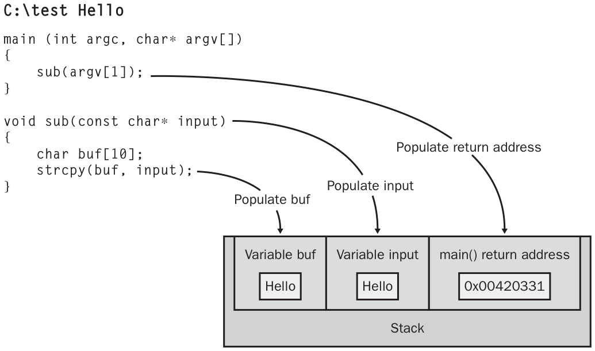

*Figure 1-1: A simple illustration of normal stack operations*

<!-- Source: Implementing.Security.for.Applications-2005-1-1.pdf, PDF page 3. -->

Notice that the first command-line parameter passed to the application is ultimately copied into the buf 10-character array. While the program runs, it stores information temporarily on the stack, including the return address where processing should continue after the subroutine has completed and the variable is passed to the subroutine. The application works fine when fewer than 10 characters are passed to it. However, passing more than 10 characters will result in a buffer overflow.

Figure 1-2 shows that same application being deliberately attacked by providing input longer than 10 characters. When the line strcpy(buf, input); is run, the application attempts to store the string “hello-aaaaaaaa0066ACB1” into the 10-character array named buf. Because the input is too long, the input overwrites the contents of other information on the stack, including the stored address that the program will use to return control to main(). After the subroutine finishes running, the processor returns to the address stored in the stack. Because it has been modified, execution begins at memory address 0x0066ACB1, where, presumably, the attacker has stored malicious code. This code will run with the same privilege as the original application. After all, the operating system thinks the application called the code.

<!-- Section 1, PDF page 4 -->

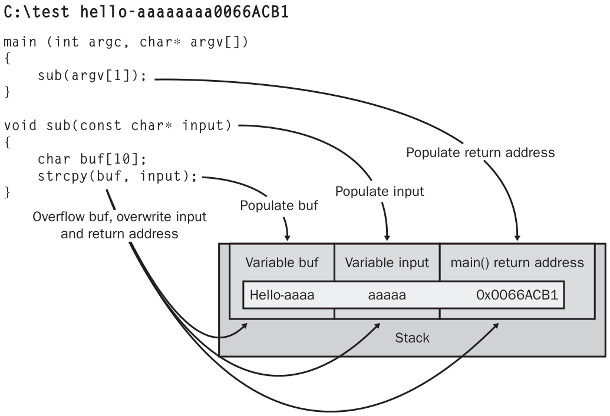

*Figure 1-2: A buffer overflow attack that redirects execution*

<!-- Source: Implementing.Security.for.Applications-2005-1-1.pdf, PDF page 4. -->

This simplified example passes the destination memory address in ASCII characters just to make it clear how the memory is overwritten. In reality, the attacker would need to pass the 4 bytes that describe the actual memory address where processing should continue to interrupt normal processing. Although you can’t type these characters with a keyboard, you can use tools that pass memory addresses to command-line applications. Additionally, the simplified example assumes the attacker has already stored malicious code in memory and just needs to run the code. Storing the code in memory would be very difficult. Usually, the malicious instructions would be passed as input to the application, where it would be stored on the stack.

Real World The CodeRed Worm Perhaps the most well-known buffer overflow exploit in recent memory is the CodeRed worm, which exploited a vulnerability in an Index Server Internet Server Application Programming Interface (ISAPI) application shipped as part of Microsoft Internet Information Server (IIS). Ironically, the vulnerable code did actually check the length of the user input to ensure it did not contain more characters than the maximum number of bytes allocated for the buffer—the recommended best practice for preventing buffer overruns. However, the developer who wrote the code verified the width of the buffer by checking the number of bytes instead of checking the number of characters. The buffer was allocated

<!-- Section 1, PDF page 5 -->

```text
using the double-byte WCHAR type (using the command, “WCHAR wcsAttribute[200]; ” in the example that follows). Therefore, although the buffer could
hold only 200 characters, it was 400 bytes long.
```

The programmer wrote code to throw an exception if the cchAttribute variable, which held the character count of the user input, was greater than or equal to the length of the wcsAttribute, which contained the number of bytes allocated to the buffer:

```text
if ( cchAttribute >= sizeof wcsAttribute)
    THROW( CException( DB_E_ERRORSINCOMMAND ) );
```

Because the input was single-byte Unicode, the programmer’s if statement would not throw an exception when the CodeRed worm passed more than 200 single- byte characters. As long as the total byte length was still less than the 400-byte length of the buffer, the if statement evaluated as true. The CodeRed worm used this discrepancy to overflow the buffer and run malicious code.

The following is the original, vulnerable Index Server ISAPI code:

```text
WCHAR wcsAttribute[200];
if ( cchAttribute >= sizeof wcsAttribute)
    THROW( CException( DB_E_ERRORSINCOMMAND ) );
DecodeURLEscapes( (BYTE *) pszAttribute, cchAttribute,  wcsAttribute,web-
Server.CodePage());
```

After the vulnerability was discovered, Microsoft fixed it by dividing the size of the wcsAttribute variable by the size of the WCHAR type. This is the fixed code:

```text
WCHAR wcsAttribute[200];
if ( cchAttribute >= sizeof wcsAttribute / sizeof WCHAR)
    THROW( CException( DB_E_ERRORSINCOMMAND ) );
DecodeURLEscapes( (BYTE *) pszAttribute, cchAttribute, wcsAttribute,web-
Server.CodePage());
```

The change was very simple; eliminating the vulnerability required adding only a single calculation. However, fixing the bug in the source code did not remove the vulnerability from the thousands of computers that were currently running the code. Customers using the application needed to retrieve and install an update issued by Microsoft before the vulnerability could be eliminated. The delay in deploying the patch gave the CodeRed worm sufficient time to infect thousands upon thousands of computers.

See Also For information about validating external input, see Chapter 2, “Using Secure Coding Best Practices.”

<!-- Section 1, PDF page 6 -->

Important This book does not provide a detailed description of the various types of buffer overflows, because the exams are focused on Microsoft Visual Basic .NET and C#. The .NET framework dramatically reduces the opportunity for buffer overflows by automatically checking that data being placed into a buffer will fit. If you program in earlier languages such as C or C++ that do not use the .NET Framework, read Chapter 5 of Writing Secure Code by Michael Howard and David LeBlanc (Microsoft Press, 2002).

Although applications built on top of the .NET Framework automatically take advantage of the platform’s buffer overflow capabilities, it is still possible for buffer overflow vulnerabilities to be discovered in the .NET Framework itself. Of course, Microsoft will release updates to fix vulnerabilities as they are discovered.

### What Is a Parsing Error?

As discussed in the topic about buffer overflows, any user input has the potential to be malicious. Buffer overflows are one of the most sophisticated ways an attacker can exploit an application, and using them to do more than generate an error requires very sophisticated skills. However, one particular set of common exploits is much easier for an attacker to take advantage of: parsing errors. Parsing errors, including canonicalization errors, CSS vulnerabilities, and SQL injection vulnerabilities, occur when an application fails to adequately check user input for potentially malicious content.

What Is a Canonicalization Error? A canonicalization error is an application vulnerability that occurs when an application parses a filename before the operating system has canonicalized it. Operating systems canonicalize filenames when processing a file to identify the absolute, physical path of a file given a virtual or relative path. Understanding canonicalization errors requires knowing that files and folders can have multiple names. If an application parses input looking for files that should not be accessed, the attacker might be able to defeat the parsing by using a synonymous name. For example, each of these names can identify the same file:

- DoNotTouch.txt

- DoNotT~1.txt

- DoNotTouch.txt.

- DoNotTouch.txt::$DATA

As you can see, an application developer who attempted to prevent users from referencing files with a .txt extension would need to do more than examine the last three characters of the filename if the operating system allowed “::$DATA” to be appended to the end of a filename.

<!-- Section 1, PDF page 7 -->

See Also For information about validating external input, see Chapter 2.

Attackers can exploit canonicalization error vulnerabilities to bypass the security checks an application makes to restrict access to files. The most common canonicalization error exploit is a canonicalization attack against a Web server, in which an attacker requests a specially formed filename to a Web server, causing the Web server to process and display a file that would not normally be accessible.

Example: Canonicalization Error A typical request from a Web server would resemble this, “ GET /docs/index.htm”. An attacker could perform a canonicalization attack by submitting a request such as, “GET /../../autoexec.bat”. This type of attack worked against many early Web servers, because the Web server passed the requested filename to the operating system without removing the “/../..” portion of the request. The operating system interpreted this to mean that it should retrieve the file from a folder not being used to store Web content.

Besides forcing Web servers to return files outside of the folders designated to contain Web content, canonicalization has been used by attackers to specify a path to an executable file. With a properly formed request, an attacker could run commands on the server using the Web server service’s own authority. Known, documented attacks include an attacker adding user accounts that allow the attacker to connect directly to the Web server as an administrator.

Although modern Web servers have been tested to ensure they are free of obvious canonicalization vulnerabilities, parsing errors can exist anywhere a user provides a filename to your application. Most parsing error exploits are targeted against Web servers, but any application that has access to files the user isn’t authorized to read or execute, and that accepts input from users as filenames, has the potential to contain a canonicalization vulnerability.

What Is Cross-Site Scripting? Cross-site scripting (CSS) attacks exploit Web server applications to cause them to display malicious content to end users. Web applications that accept input from a user and include that input on Web pages viewed by other users might be vulnerable to cross-site scripting attacks. These applications include Web forum applications, guestbooks, and any others intended to display comments. A CSS attack is another form of a parsing error.

<!-- Section 1, PDF page 8 -->

Example: Cross-Site Scripting A simple guestbook application might accept and display comments from users. Most users enter a comment using standard characters, and the guestbook functions as intended. However, a malicious attacker that controlled a server with the host name attacker.contoso.com could enter a comment that contains HTML code such as the following:

```text
Hi, great page!
```

When this comment is displayed to other users, the users’ browsers submit a request for the file /user-counter.aspx from the server named attacker.contoso.com. Although this attack would not compromise files on the client or server computers nor give the attacker elevated privileges, it would compromise the privacy of users visiting the guestbook. The attacker could examine the log files generated from the requests submitted to the attacker.contoso.com server and use these log files to identify the IP addresses of visitors to the site, the types of browsers they are using, and the users’ operating systems.

More sophisticated CSS attacks include client-side scripts. After injecting the script into a page, the Web browsers of future visitors will run the client-side script. Although the capabilities of client-side scripts vary, as do the permissions granted to client-side scripts, the scripts have the potential to compromise the user’s privacy, infect the user’s computer with a virus, and even grant an attacker elevated privileges to the computer.

Security Alert Be especially concerned about CSS attacks if users are granted a higher- than-normal level of trust to your Web application. In particular, Internet Explorer might grant scripts that are downloaded from a server on an intranet higher privileges than those downloaded from a Web server on the Internet. Remember—attacks come from within the company’s network, too.

What Is SQL Injection? SQL injection attacks insert database commands into user input to modify commands sent from an application to a back-end database. Applications that employ user input in SQL queries can be vulnerable to SQL injection attacks.

Consider the following simplified C# source code, intended to determine whether an order number (stored in the variable Id and provided by the user) has shipped:

<!-- Section 1, PDF page 9 -->

```text
sql.Open();
        sqlstring="SELECT HasShipped FROM orders WHERE ID=‘“ + Id + “‘";
        SqlCommand cmd = new SqlCommand(sqlstring,sql);C#
        if ((int)cmd.ExecuteScalar() != 0) {
            Status = “Yes";
        } else {
            Status = “No";
        }
```

```text
sql.Open()
        sqlstring="SELECT HasShipped FROM orders WHERE ID=‘“ + Id + “‘"
        Dim cmd As SqlCommand =  New SqlCommand(sqlstring,sql)VB        If CType(cmd.ExecuteScalar() <> 0,Integer) Then
            Status = “Yes"
        Else
            Status = “No"
        End If
```

Legitimate users will submit an order ID such as, “1234”, and the code sets the Status variable to “Yes” if the HasShipped value in the row with that ID number is true. However, a malicious attacker could submit a value such as, “1234’ drop table customers – ”. The preceding C# code would then construct the following SQL query:

```text
SELECT HasShipped FROM orders WHERE ID=‘1234’ drop table customers --
```

Note The exact structure of SQL commands varies between database servers. Some database servers, for example, require each command to be separated by a semicolon. Microsoft SQL Server does not have this requirement, however.

Assuming a table named customers existed, and the application had the right to drop the table, the table would be lost. Depending on the application and the database configuration, such maliciously malformed queries can also be used to retrieve data from the database and run operating system commands.

### What Are Denial-Of-Service Attacks?

A denial-of-service (DoS) attack prevents legitimate users from accessing a network service. A DoS attack does not give the attacker a higher level of access; instead, it denies legitimate users from accessing the application. Although the most dangerous attacks allow an attacker to gain elevated privilege on the target computer, DoS attacks can be very costly to victims. Generally, the loss of private information is much more devastating than the damage done by a denial-of-service attack, and as a developer, you should focus more of your energy on preventing potential vulnerabilities that an attacker could exploit to reveal information.

<!-- Section 1, PDF page 10 -->

Important Denial-of-service attacks often target bugs that you would not otherwise classify as security vulnerabilities. For example, fixing the vulnerability for a client-server application that prompts the user to provide her first name but crashes when she provides a name longer than 200 characters might seem like a low priority. After all, reproducing the error requires conditions that would never occur under normal circumstances. However, if an attacker discovers that your application crashes under this circumstance, the attacker can cause your application to repeatedly fail by intentionally providing an extremely long first name.

Not all denial-of-service attacks cause an application to fail outright. The potential for a denial-of-service attack exists any time a server uses more resources to process a request than the client uses to submit the request. For example, if you are creating a client-server application that allocates 10 MB of memory for each authenticated user, you could use the following process:

1. Receive request from user.

2. Allocate memory for user.

3. Request and receive authentication from user.

However, this application would be extremely vulnerable to a denial-of-service attack because it allocates memory before authenticating the user. Allocating the memory after authenticating the user would make the application much more resistant to denial-of-service attacks, because the attacker would be required to provide credentials before the server allocated resources. Therefore, the following application flow would be more secure:

1. Receive request from user.

2. Request and receive authentication from user.

3. Allocate memory for user.

### What Is Cryptography Cracking?

Cryptography cracking is the process of capturing encrypted content and deriving the original, unencrypted data without a key. Cryptography cracking is a complex and costly process, and attackers generally rely on it only when other, simpler attacks against an application fail. If the attacker can successfully crack the encryption, the attacker can gain access to the unencrypted communications.

<!-- Section 1, PDF page 11 -->

How Communications Are Compromised Communications between a client and a server occur across a network. If an attacker can gain control of that network hardware, the attacker might be able to capture the communications. This capture will, at a minimum, reveal important information about how the application works. Additionally, it can reveal private information, such as user names and passwords, that the attacker can use to gain elevated privileges.

Only the most sophisticated attackers are capable of cracking encrypted cyphertext. Even with the proper skills and tools, it can take an attacker years (or even thousands of years) to identify the unencrypted data given in an encrypted message. However, many cryptographic techniques have flaws that allow the attacker to crack the cryptography much faster. Additionally, a developer who does not follow best practices for implementing encryption might introduce weaknesses into an otherwise strong encryption method. For example, an application that uses a strong encryption method but stores the private key in a location that is publicly accessible to an attacker might allow an attacker to gain access to private, encrypted communications.

See Also For more information about cryptography, see Chapter 8, “Protecting Data by Using Cryptography.”

### What Are Man-In-The-Middle Attacks?

A man-in-the-middle (MITM) attack is a sophisticated attack in which an attacker impersonates a server to intercept requests from a legitimate client. Then, the attacker impersonates the user to the destination server, as shown in Figure 1-3. At that point the attacker can examine and potentially modify the communications between the client and server.

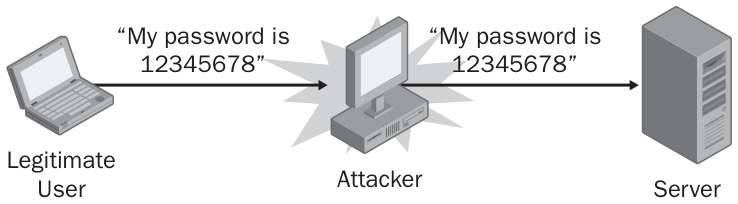

*Figure 1-3: Man-in-the-middle attack*

<!-- Source: Implementing.Security.for.Applications-2005-1-1.pdf, PDF page 11. -->

Any application that does not require both encryption and authentication is susceptible to man-in-the-middle attacks. Man-in-the-middle attacks are usually prevented by implementing authentication and encryption at the level of the operating system, rather

<!-- Section 1, PDF page 12 -->

than at the application level. IP Security (IPSec) is commonly used to prevent man-in- the-middle attacks between two hosts without requiring individual applications to implement server authentication and encryption.

See Also For more information about IPSec and cryptography, see Chapter 8.

### What Is Password Cracking?

Password cracking is an attack that tries to guess a user’s password by attempting hundreds, thousands, or millions of passwords. Any application that authenticates a user by using static credentials is susceptible to password cracking. In other words, if you prompt a user for a user name and password, an attacker can guess passwords until he finds a valid combination. Normally, the attacker does not manually type user names and passwords at a keyboard, but instead automates the password-guessing process using a script.

There are two approaches to guessing passwords: brute force and dictionary. Whereas a true brute force attack uses a methodical approach to guessing passwords (“a”, “b” … “aaa”, “aab to zzzzzzz”), password-cracking attacks usually use a password dictionary to increase the chances of finding a valid password quickly. Password dictionaries contain lists of commonly used passwords. Password cracking using a dictionary is very effective, because most users choose easy-to-remember words and names as passwords. Lesson 2 in this chapter discusses techniques for limiting the effectiveness of this type of attack by using error reporting.

### Types of Attacks That Specific Applications Are Vulnerable To

Table 1-1 shows which types of applications are vulnerable to each of the major types of attacks.

**Table 1-1 Application Vulnerability Matrix**

| Attack | ASP.NET Web Application | .NET Framework Windows Forms Application |
| --- | --- | --- |
| Buffer overflow attack | O | O |
| Canonicalization error attack | X | X |
| Cross-site scripting | X | O |
| SQL injection | X | X |
| Denial-of-service attack | X | X |
| Man-in-the-middle attack | X | X |
| Password cracking | X | X |
| Cryptography cracking | X | X |

O = generally not vulnerable, X = potentially vulnerable.

<!-- Section 1, PDF page 13 -->

### Practice: Evaluating Security Threats

In this practice, you will answer questions that require you to explain how to exploit vulnerable applications. If you are unable to answer a question, review the lesson materials and try the question again. You can find answers to the questions in the “Questions and Answers” section at the end of this chapter.

1. An application on the Internet that does not require authentication would potentially be vulnerable to which of the following types of attacks? (Choose all that apply.)

a. Buffer overflows

b. Parsing errors

c. Denial-of-service attacks

d. Man-in-the-middle attacks

e. Compromising communications

f. Password cracking

2. You created a Windows forms application that runs on a kiosk in a shopping mall to gather the name, address, and other demographic information from shoppers. The information is stored within a SQL Server database on the same computer. Your application is potentially vulnerable to which of the following types of attacks? (Choose all that apply.)

a. Buffer overflows

b. Parsing errors

c. Denial-of-service attacks

d. Man-in-the-middle attacks

e. Compromising communications

f. Password cracking

3. Which of the following types of attacks can lead to private information being compromised? (Choose the best answer.)

a. Buffer overflows

b. Parsing errors

c. Denial-of-service attacks

d. Man-in-the-middle attacks

e. Compromising communications

f. Password cracking

<!-- Section 1, PDF page 14 -->

4. Think back to the last application you developed. Theoretically, which types of attacks could that application have been vulnerable to? Of those potential vulnerabilities, which do you feel you were sufficiently protected against? Did you use defense-in-depth, secure coding practices, or other techniques to limit your risk?

### Lesson Summary

- Any developer’s application can have a security vulnerability, because anyone can make a mistake, and new security attacks are discovered constantly.

- Although specific attacks change regularly, most attacks fall into one of several different categories:

❑ Attackers use buffer overflow attacks by providing input longer than the application was designed to process. The attack will corrupt memory and can be used to run malicious code.

❑ Parsing errors, including canonicalization errors, CSS, and SQL injection, exploit applications that fail to successfully remove invalid characters from user input. A malicious attacker can exploit this type of vulnerability by generating input that includes special characters and commands that will be interpreted by the operating system, Web server, or database, rather than by the application.

❑ Denial-of-service attacks take systems offline, preventing legitimate users from accessing the resource.

❑ Even though cryptography is the best way to reduce the risk of private communications being compromised, it is vulnerable to being cracked by a skilled attacker.

❑ Man-in-the-middle attacks give an attacker access to network communications, but are difficult to implement because they require the attacker to impersonate both the client and the server.

❑ Password-cracking attacks attempt to compromise credentials by repeatedly guessing passwords until authentication is successful.

- Different applications are more likely to be vulnerable to different types of attacks, depending on the development platform and whether the application uses a Web or a Windows Forms front end.

<a id="section-2"></a>

## Implementing Security for Applications-2005

Source: [Implementing.Security.for.Applications-2005-1-2.pdf](Implementing.Security.for.Applications-2005-1-2.pdf) — section 2, 18 pages.

<!-- Section 2, PDF page 1 -->

### Lesson 2: Implementing Best Practices to Design Secure Applications

Before you write the first line of code for an application, you must think about how the application’s design will limit the potential for vulnerabilities. Having a design that takes security into account will limit the damage done by any mistakes you make, ease the burden of releasing security updates, and reduce the likelihood of your application being successfully exploited by an attacker.

The goal of Lesson 1 was to demonstrate that applications must be able to survive hostile environments because attacks are varied and numerous. To grasp the need for defense-in-depth, you must acknowledge that software is written by people, and that people make mistakes. The attacks described in Lesson 1 exploit those mistakes. You cannot hope to make your applications invulnerable by eliminating every mistake. Instead, strive to create the fewest number of mistakes possible, and use defense-in- depth to reduce the likelihood that your remaining mistakes will be exploited.

See Also This lesson provides an introduction to the concepts of secure application design. For a thorough discussion on the complete secure development process, threat modeling, and risk management, read Writing Secure Code by Michael Howard and David LeBlanc (Microsoft Press, 2002).

After this lesson, you will be able to

- Describe the purpose of defense-in-depth.

- Describe the SD3 strategy that Microsoft developers use to implement defense-in-depth.

- Design security features into your application, and use a secure design process.

- Design applications to be secure by default.

- Design applications to maintain security during and after deployment.

Estimated lesson time: 45 minutes

### What Is Defense-In-Depth?

Defense-in-depth is a proven technique for reducing the exposure of vulnerabilities. Network engineers use defense-in-depth to protect computers on a network by providing multiple layers of protection from potential attackers. For example, an engineer might design a network (such as the one shown in Figure 1-4) with three layers of packet filtering: a packet-filtering router, a hardware firewall, and software firewalls on each of the hosts (such as Internet Connection Firewall). If an attacker manages to bypass one or two of the layers of protection, the hosts will still be protected from communications that have not specifically been allowed.

<!-- Section 2, PDF page 2 -->

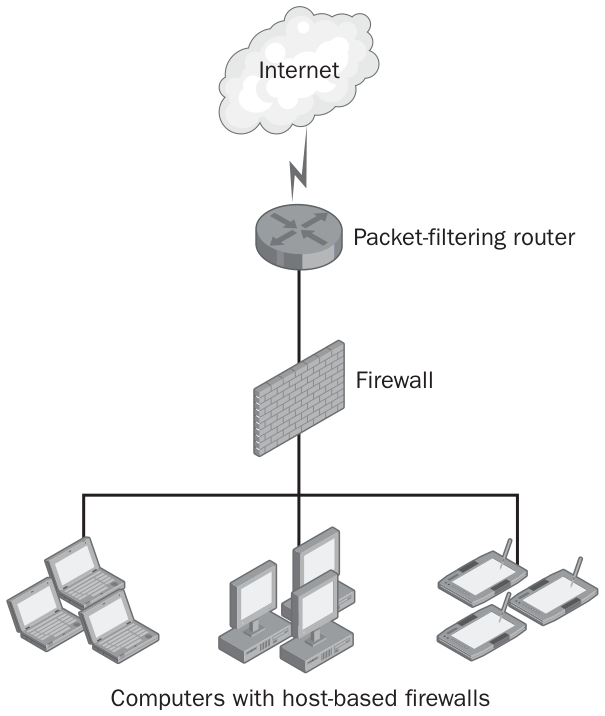

*Figure 1-4: Defense-in-depth used to protect a network*

<!-- Source: Implementing.Security.for.Applications-2005-1-2.pdf, PDF page 2. -->

Networks should be designed with defense-in-depth in mind, but the concept must be extended deep into the code that makes up the applications themselves. As a developer, you cannot rely on customers providing network-level protection. First, many customers will be unable or unwilling to properly secure their networks. Second, configuring your application to work in different environments might require your customers to allow specific requests through their firewalls. If nothing else, the network must be configured to allow communications between the client and server components of a network application. What Is the SD3 Strategy?

To guide application developers to follow defense-in-depth principles, Microsoft uses a strategy nicknamed SD3, which stands for secure by design, secure by default, secure in deployment. The tenets of this strategy include:

- Secure by design Developers follow secure coding principles and implement security features to offset potential vulnerabilities.

- Secure by default Applications that are secure by default assume that most end users install the application without changing the default settings, and therefore require these users to specifically select features that might not be used or that might reduce security.

<!-- Section 2, PDF page 3 -->

- Secure in deployment The application can be kept secure after installation by updating it with security patches, monitoring it for attacks, and auditing it for abuse.

No single human error will allow an application that uses defense-in-depth to be exploited. For example, consider an internal client-server accounting application that allows members of the accounting team to view and edit financial data. If the programmer of the client-side front-end application forgot to parse user input, an attacker could input SQL commands and perform a SQL injection attack against the server. However, one of the secure by design principles states that input should be parsed in every function that receives the input. As a result, the server would detect invalid input from the client and reject the query.

The secure in deployment tenet states that the application must include monitoring and auditing features so that the organization’s application-monitoring software can detect the attack. Being able to detect the attack would enable support staff to track down the user who attempted to initiate the attack and contact human resources to help prevent that user from attacking the system in the future. Additionally, the support staff would be able to identify that the client application contained a security vulnerability, notify the developer of the bug, and then release an update to all clients. In this example, defense-in-depth did more than protect critical data from being exploited. It allowed the vulnerability, the attack, and the attacker to be identified, improving the security of the application in the long term.

Best Practices for Implementing the Secure by Design Tenet Secure by design is the most complex of the SD3 tenets. It consists of using security features, such as cryptography, authentication, authorization, and firewalls, to reduce the risks of several types of attacks. Secure by design also dictates least privilege, separation of privilege, and reducing the attack surface of the application. Effectively implementing the many secure coding best practices, described throughout this book, requires the use of a security-oriented design process. This section presents the best practices for implementing the secure by design tenet.

### When Your Application Stores or Transmits Data That Attackers Want, Use Cryptography

Often, attackers won’t directly attack your application, but they will attempt to compromise data located in memory, stored on the hard disk, or being transferred across the network. Today, the best way to protect this data is by using cryptography. Cryptography encrypts information in such a way that it can be deciphered only by users with a valid key. If your application stores or transmits data that would be potentially useful to an attacker, especially personal information about people, financial information, or

<!-- Section 2, PDF page 4 -->

authentication credentials, encrypt this data. You can implement this encryption yourself, or require your end users to use platform encryption features such as Encrypting File System (EFS), Secure Sockets Layer (SSL), and IP Security (IPSec).

See Also For more information about cryptography, see Chapter 8. Isolated storage, described in Chapter 4, “Taking Advantage of Platform Security,” is an excellent way to use cryptography.

### Use Authentication Mechanisms Built into the .NET Framework

Authentication is the process of proving a user’s identity and is most often done by requiring a user to provide a user name and password. When designing your application, consider how you will authenticate users. Authentication mechanisms are frequently attacked by attackers using brute force or dictionary password-cracking tools, or by attackers who can capture authentication data from the network. Fortunately, designing an authentication method is fairly simple, because you can and should leverage the authentication mechanisms built into the .NET framework.

See Also For more information about authentication, see Chapter 5, “Implementing Role-Based Security.”

### Use .NET Framework APIs for Authorization

After a user is authenticated, your application must determine whether the user has sufficient rights to perform the action she has requested—this is known as authorization. Although authorization often can be controlled by configuring access control lists (ACLs) for files, databases, and other objects used by your application, you might have to examine a user’s authorization within your application. The .NET Framework provides Application Programming Interfaces (APIs) for examining a user’s properties, including group memberships.

See Also For more information about authorization, see Chapter 5.

### Use Standard Network Protocols for Network Communications When Possible

Firewalls analyze network traffic and drop all packets that are not specifically allowed. Even though designing an application for security does not require you to implement your own firewall functionality, you must plan on firewalls being present on the networks where your application is deployed. To improve compatibility with firewalls, leverage standard network protocols for network communications whenever possible.

<!-- Section 2, PDF page 5 -->

For example, use .NET remoting or Web services to communicate between two computers rather than design a network protocol from scratch. Administrators implementing your application will probably know how to allow standardized protocols through firewalls, which reduces the likelihood that they will configure the firewall to be too permissive.

Real World Top Mistakes Developers Make When Choosing a Network Protocol Here’s a list of the top mistakes I’ve seen developers make when using network protocols:

- Developers did not document the port numbers they used This requires the system administrator to use a protocol analyzer to identify each of the port numbers so that the administrator can properly configure firewalls. This can lead to a lengthy process of trial and error, and if the administrator misses a port number, it can lead to difficult-to-troubleshoot application errors (and support calls to you!).

- Developers used port numbers seemingly pulled out of thin air (or, perhaps, based on their birth dates) Sometimes, these port numbers conflict with existing applications, which means the two applications cannot be run on a single computer.

- Developers did not allow port numbers to be redefined Administrators often change port numbers to eliminate application conflicts and to reduce the likelihood of the service being identified with a port scan.

- Developers used multiple port numbers Some applications require five or six ports to be opened on a firewall, which is difficult to manage.

- Developers used UDP User Datagram Protocol (UDP) is sessionless, which makes it very difficult for the firewall to filter packets being sent to the clients. After all, without a session, the firewall can’t determine whether the packet is part of an expected response or a malicious attack.

- Developers initiated connections from the server to the client Most firewalls block all incoming connections by default, making this type of protocol particularly difficult to configure. When designing the network protocol, assume that you can establish a Transmission Control Protocol (TCP) session to the server but cannot establish a TCP session to a client.

<!-- Section 2, PDF page 6 -->

### Implement the Principle of Least Privilege

Design and implement your applications so that they use the least privileges necessary to carry out any action. Doing so reduces the damage that can be done if your application is successfully misused by an attacker. For example, if you need to read the contents of a file, open that file for read access only. Least privilege is more than using the minimal level of file lock, however. During the design phase, plan to allow your application to run without Administrator or System privileges. Further, document specifically what privileges are necessary to allow end users to configure accounts to run your application with minimal permissions.

For example, if your application needs to update a registry value in the HKEY_LOCAL_MACHINE hive, document that requirement because standard user accounts lack that permission. If your application only reads the Customers table in a database but must both read and write the Orders table, specify that those permissions be granted or restricted during the setup process. Whenever possible, plan to provide setup procedures that handle the configuration of ACLs automatically.

Tip Remember these two rules:

1. Interactive applications, such as the graphical front-end of an application, should run with standard User privileges, not Administrator privileges.

2. Non-interactive applications such as services should run in the context of a restricted user account created specifically for the service. Services should not run as System.

### Use a Security-Oriented Design Process

Even the process that you use to design your application should consider security. Here is an example of a security-oriented design process:

1. The organization assigns a single person to be ultimately responsible for security issues. This person can be a developer, manager, or the Chief Security Officer.

2. All developers receive security training.

3.• All developers follow the code review processes and coding guidelines that the organization has in place to ensure all developers adhere to secure design practices.

4.• Engineers with security experience analyze all code for security vulnerabilities before releasing it to customers. Requiring your application to withstand a tiger team analysis from an objective outside organization can identify vulnerabilities before the application is deployed in production environments.

<!-- Section 2, PDF page 7 -->

### Implement the Separation of Privilege Principle

Design your application so that day-to-day functions run in a separate process and separate security context from management functions. Figure 1-5 shows a simplified design of an e-commerce application without separation of privilege. In this example, the entire application is run in the context of the ASP.NET user account. This requires that the ASP.NET user account have privileges to perform management tasks, such as deleting rows from the Orders table. Additionally, application management functionality such as the Management.ShipOrder() and Management.AddInventory() functions could be called by an attacker who would be able to compromise the application.

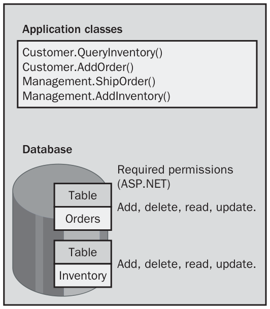

*Figure 1-5: An e-commerce application designed without separation of privilege*

<!-- Source: Implementing.Security.for.Applications-2005-1-2.pdf, PDF page 7. -->

Figure 1-6 shows the same simplified e-commerce application designed using separation of privilege. This example implements separate applications for use by customers and internal management. The Customer application uses the ASP.NET account to access resources, whereas the Management application uses impersonation so that it runs in the context of an authenticated user. In the event an attacker successfully exploits the Customer application, this design will limit the damage the attacker can do because the ASP.NET user account’s permissions are restricted to only those permissions required for end users. Specifically, in this design, the ASP.NET user account does not need permission to update, add, or delete rows of the Inventory table. Therefore, an attacker would not be able to insert or change records of inventory. However, since internal users will have these permissions, the Management application will be able to update the inventory when required.

<!-- Section 2, PDF page 8 -->

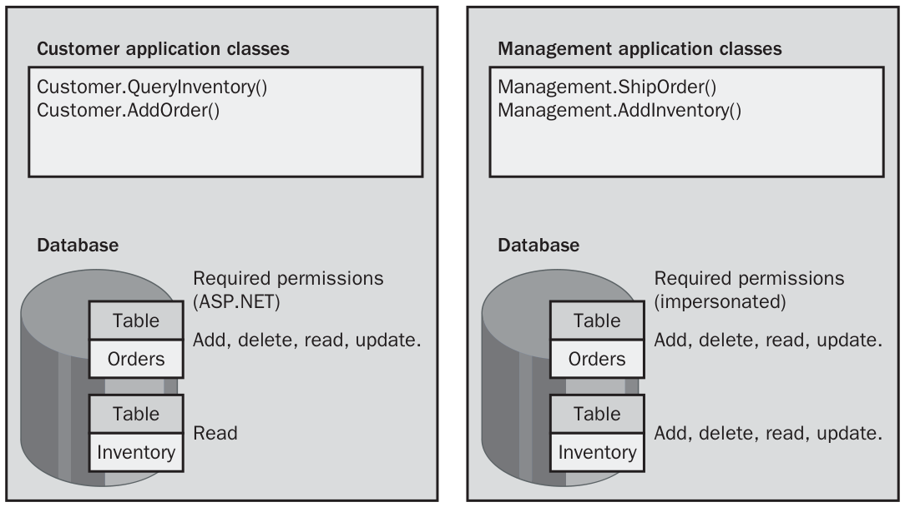

*Figure 1-6: An e-commerce application designed with separation of privilege*

<!-- Source: Implementing.Security.for.Applications-2005-1-2.pdf, PDF page 8. -->

See Also For more information about impersonation, see Chapter 5.

### Follow Known Techniques for Reducing the Attack Surface

Your application should minimize the attack surface by offering the simplest possible user interface and exposing the fewest number of ways for users (including other applications) to submit requests. Reducing the attack surface gives attackers fewer targets, which reduces the likelihood of an exploit. Use the following techniques to reduce attack surface:

- Listen for inbound connections on the fewest possible number of ports.

- Minimize the number of services running.

- Minimize the number of pages in an ASP.NET application.

- Minimize the number of accounts authorized to use your application, while still following the principles of least privilege and separation of privilege.

- Minimize the number of authentication methods available to users, while still providing flexibility.

- Minimize the number of methods that accept input from users.

- Minimize the number of application components installed by default.

<!-- Section 2, PDF page 9 -->

### Best Practices for Implementing the Secure by Default Tenet

Experience shows that most users accept every default setting when installing an application. After all, many users install the application before reading the accompanying documentation. As a result, your application’s default settings will almost always be the settings used in production environments.

You cannot burden your users by instructing them to change default settings or uninstall unnecessary components to improve security. After the application is up and running, there’s an excellent chance the user will never again reconfigure it. Instead, you must make your application’s default settings as secure as possible. If those default settings don’t provide functionality that your users need, they’re better off manually adding the functionality later.

### Ensure That the Setup Routine’s Default Settings Install Only Necessary Application Components

Many applications, particularly those written for Windows systems, are designed to provide maximum functionality after a default installation. Developers choose to enable as many features as possible by default to make the application easier for administrators to configure. Although these developers’ intentions are noble, experience has shown that modern applications must be able to survive in a hostile environment. Each feature that is enabled in an application is another potential security vulnerability.

To reduce the likelihood of end users being affected by a vulnerability in an optional component, your setup routine’s default settings should install only necessary application components. Users should be prompted to select optional components during the setup procedure and have the option to add those components later by re-running setup.

Real World The Importance of Minimizing Components Installed by Default IIS, a Windows component, provides an excellent example of the importance of minimizing the components installed by default. IIS 5.0 was included with Microsoft Windows 2000 Server. Not only was IIS installed by default, but many nonessential subcomponents were also installed. In 2001, a vulnerability was discovered in the Index Server ISAPI extension, one of the nonessential IIS subcomponents installed by default. Soon thereafter, the CodeRed worm began exploiting this vulnerability. CodeRed propagated quickly, and infected thousands of computers. Very few of those computers were actually using the Index

<!-- Section 2, PDF page 10 -->

Server ISAPI extension, however. If IIS 4.0 had followed the secure by default principle, the Index Server ISAPI extension would not have been installed on the vast majority of those systems, and the costs associated with the CodeRed worm would have been minimal.

You can learn from the mistakes made with IIS 4.0, or you can follow the example set by IIS 6.0 (included with Windows Server 2003). First, Windows Server 2003 does not install IIS 6.0 by default. If an administrator does choose to install IIS, she is prompted to enable optional functionality such as the FrontPage Server Extensions and ASP.NET, as shown in Figure 1-7. Both of these features are commonly used, but neither is selected by default. Administrators must explicitly choose to enable these features. That requirement alone will not prevent vulnerabilities in IIS from being exploited, but it will reduce the number of compromised computers.

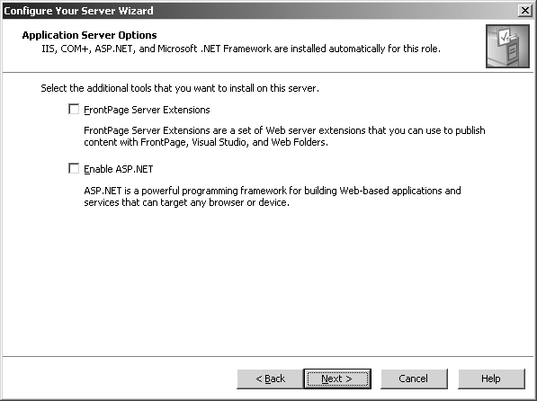

*Figure 1-7: Optional IIS 6.0 components not installed by default*

<!-- Source: Implementing.Security.for.Applications-2005-1-2.pdf, PDF page 10. -->

### Configure the Most Restrictive Permissions Possible During Configuration

In addition to minimizing the number of installed components, take care to configure the most restrictive permissions possible during configuration. To use Windows as an example once again, earlier versions of Windows granted the Everyone group Full Control over most files, folders, and registry settings. Since the release of those earlier versions of Windows, Microsoft learned many important secure development lessons.

<!-- Section 2, PDF page 11 -->

As a result, Windows Server 2003 provides much more restrictive permissions, dramatically reducing the potential for vulnerabilities to be exploited in systems with the default configuration settings. End users still have the opportunity to modify security settings to make them less restrictive, but they must consciously select those security settings.

### Implement Application Diversity

The most wide-spread worms, including the CodeRed and SQLSlammer worms, propagate by connecting to random IP addresses using a well-known port number. For example, SQLSlammer always sends packets with a destination port of 1434/udp, the port Microsoft SQL Server listens on by default. The port number a SQL Server listens on is configurable, but because SQL Server uses 1434/udp by default, the vast majority of installations listen on the default port number.

One of the ways to avoid being infected with the SQLSlammer worm is to simply change the port number to something other than the default. If the SQL Server installation routine had provided a randomized default port number, a worm such as the SQLSlammer would not have been able to propagate as quickly. Rather than sending attacks to random IP addresses with static port numbers, the worm would have needed to send packets to both random IP addresses and random port numbers, which would have dramatically decreased the possibility of finding vulnerable computers. Since there are 65,535 possible port numbers, the use of random port numbers would have slowed the spread of the SQLSlammer worm to a crawl. In fact, with sufficient application diversity, you would never have heard of SQLSlammer.

Note Now is a good time to think back to the definition of defense-in-depth. Remember, the goal is not necessarily to eliminate every vulnerability in your code, but to reduce the possibility of vulnerabilities being exploited. Application diversity would not have prevented the vulnerability that the SQLSlammer worm exploited, but it would have stopped the worm’s rapid spreading.

Application diversity does have a drawback—it complicates configuration and management. In particular, if the port number a database server uses is randomized, the administrator must configure clients with both the database’s IP address and port number. Additionally, firewalls and management tools will need to be individually configured with the custom port number. This requires little additional work on internal networks, where administrators already track this type of configuration information. However, changing the port number on public services can be confusing to end users. For example, end users connecting to an e-commerce application can be expected to type the URL http://www.contoso.com/. However, they cannot be expected to remember http://www.contoso.com:5293/.

<!-- Section 2, PDF page 12 -->

Randomizing server port numbers is the most obvious way to take advantage of application diversity to provide an additional layer of protection against application exploits, because most modern worms only attempt to contact an application’s well-known port number. However, you can also provide diversity for folder names, file names, file extensions, and other application settings. For example, some versions of IIS installed sample content that an administrator could use to verify that the Web server was running correctly. Later, vulnerabilities were discovered in this content, and worms exploited these vulnerabilities to quickly propagate. Using random folder names to store this sample content would not have prevented the vulnerability, but it would have prevented a worm from exploiting it in an automated fashion, because the worm would need to first discover the path to the sample content, which would be different on every server.

### Best Practices for Implementing the Secure in Deployment Tenet

The third tenet of Microsoft’s secure development strategy is secure in deployment. The development process isn’t finished when the application is released; you must keep the application secure as your customers run it. The following list describes the three best practices.

- You must have a process for identifying newly discovered security vulnerabilities and issuing updates that remove those vulnerabilities. This is perhaps the most important best practice.

- You must have a system in place to allow customers to monitor events that take place while your application is running; customers must be able to detect whether your application is actively being attacked.

- Your application must handle failures and errors in a secure fashion, revealing minimal information to end users, while allowing administrators to identify and resolve the problem.

These are discussed in more detail in the next few sections.

### Have a Process for Identifying Newly Discovered Security Vulnerabilities and Issuing Updates

Microsoft itself provides an interesting example of how to handle security updates, because they have an extremely large installed base of customers, and new vulnerabilities are discovered in Microsoft software on a regular basis. The security update process begins when a new vulnerability is reported to the Microsoft Security Responses Center (MSRC) by a customer, a security organization, or an internal Microsoft employee. After the MSRC verifies that the vulnerability is genuine, they determine the

<!-- Section 2, PDF page 13 -->

severity of the vulnerability. The severity takes into account the potential damage an exploit could cause, the number of customers affected, and whether an exploit already exists.

Based on the severity, Microsoft will release an update to customers using the Windows Update Web site. Additionally, updates can be distributed directly to individual computers using the Automatic Updates feature available for Windows 2000 and later operating systems, or distributed throughout entire organizations by using Microsoft Software Update Services (SUS). Many individuals and organizations choose to use these tools to automatically deploy security updates; IT professionals have the option of subscribing to an e-mail service to be notified when new vulnerabilities are discovered and patches or workarounds are announced.

See Also For more information about the MSRC, see “A Tour of the Microsoft Security Response Center” on the TechNet page of the Microsoft Web site at http:// www.microsoft.com/technet/archive/community/columns/security/essays/sectour.mspx .

Most software does not require an infrastructure as robust as the MSRC to manage security vulnerabilities. However, Microsoft provides an interesting model for discovering vulnerabilities, issuing updates, and notifying customers. Figure 1-8 shows a typical process that every application developer should provide to customers. Communication is critical: you must provide a way for customers to notify you about potential security vulnerabilities, and for you to notify customers about verified vulnerabilities, patches, and workarounds.

Design Patching takes time. Make sure management allocates development time to creating and releasing security updates.

The simpler it is for your customers to discover and deploy patches, the more secure your application will be in deployment, so provide security updates immediately as vulnerabilities are discovered. Because the process of installing the updates requires critical systems to be taken offline for several hours, your customers will be less likely to install your patches within the first few days. In fact, when faced with updates that consume hours of labor or cause extended downtime, many customers choose to simply ignore the patch. When designing your application, you must plan for updates to be installed with minimal downtime and administrative overhead.

<!-- Section 2, PDF page 14 -->

Discover security vulnerability

Is it a genuine No vulnerability?

Yes

Notify customers

Document Can it be No workaround and patched? notify customers

Yes

Release update and notify customers

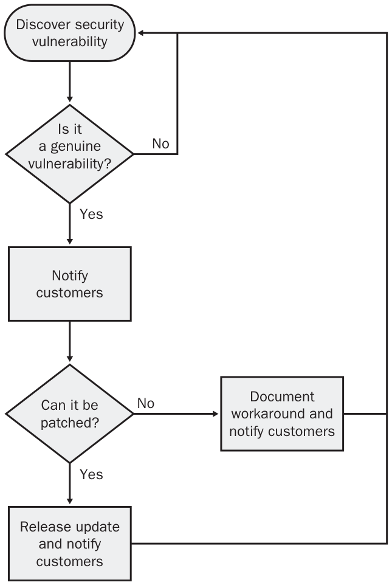

*Figure 1-8: A typical security vulnerability discovery and patch release process*

<!-- Source: Implementing.Security.for.Applications-2005-1-2.pdf, PDF page 14. -->

Real World Why People Might Resist Deploying Updates We’ve seen it over and over again: a vulnerability is discovered, and the software developer releases a patch within a few weeks. Then, months later, a worm or virus is released that exploits the vulnerability. The malicious software shouldn’t spread at all, right? After all, the developer released a patch for it.

Some application developers have a bit of an attitude when it comes to customers delaying the deployment of their patches. You have to remember: your customers rely on your application. They have to allocate time (often, weeks of time) to testing the update to verify that it will not break their critical services. To install your patch, they need to schedule staff to stay after hours to install the update, and then make sure that your application still works as expected. They also need to schedule time for your application to be offline while the patch is being applied.

<!-- Section 2, PDF page 15 -->

In organizations that run 24 hours a day, even a few minutes of downtime must be scheduled weeks in advance.

Many organizations might choose to not deploy your updates at all. This is understandable, because the cost of deploying updates is huge. Sometimes, deploying an update causes more problems than it fixes, which further increases the cost. All security updates fix security vulnerabilities, but most of those updates would never have been successfully exploited. In other words, it usually doesn’t cause a problem to skip an update, and the labor and downtime saved has an immediate benefit.

Yes, systems administrators should make an effort to promptly deploy security updates. But if they don’t, be sympathetic to their reasons.

### Have a System That Allows Customers to Monitor Events That Occur While Your Application Runs

Has your application ever been attacked or exploited? How would you know?

Systems administrators monitor applications to identify problems that are causing downtime, as well as to detect potential problems before they have an impact on end users. The simplest form of monitoring checks is to determine whether a particular application is responding to requests. If the application fails to respond, the monitoring system notifies an administrator.

In the security world, intrusion detection systems (IDS) use application monitoring to determine when an attack is currently under way, and whether an attacker has successfully compromised an application. IDS use complex algorithms to detect signs of an attack. For example, a series of 20 unsuccessful authentication attempts could signal that an attacker is actively using a password-cracking technique to identify a user’s credentials. If an administrator is able to respond while the attack is under way, the administrator might be able to collect evidence that can be used to prosecute the attacker, identify the vulnerability that the attacker is attempting to exploit, or simply block traffic from the attacker’s network.

Your application does not need to include IDS capabilities, but it should provide information that can be used to monitor your application for signs that an attack is under way, and it should be capable of recording detailed information that can give administrators clues about an attacker’s actions. If you use the platform’s authentication and authorization systems, you can take advantage of the operating system’s auditing capabilities. For example, if your application authenticates users with its Windows user account, an event can be automatically added to the event log every time a user attempts to authenticate—without requiring you to write a single line of code.

<!-- Section 2, PDF page 16 -->

Provide similar auditing capabilities to monitor custom authentication mechanisms for signs of password-cracking attacks, and to record malformed requests for signs of attacks targeting parsing error vulnerabilities. Adding events to the Application or Security event log is simple, and most monitoring systems can analyze custom application events for problems. Additionally, allow customers to configure auditing for other events that might be significant, such as updating the application’s configuration, adding users, and changing privileges. Enabling customers to control the level of auditing will give them the ability to carefully analyze application usage while preventing event logs from becoming filled unnecessarily.

When recording events, record the type of request and as much information about the user’s identity as possible. For example, you could add the following information from a Web request to the event log:

- Type of request

- User name (if authenticated)

- Client IP address

- Client agent (for example, the Web browser name and version)

- Client computer name

- Client operating system

When generating an event about a client request, always record as much information as possible about the client. However, it’s important to understand that you cannot trust information provided by the client. For example, an attacker could create a tool to submit requests to a Web application, and have that tool incorrectly identify itself as Microsoft Internet Explorer. Similarly, it is theoretically possible for an attacker to spoof another’s IP address, or to send requests through another computer, effectively hiding the original IP address. Although this client information cannot be trusted, always record it, because it might be useful in understanding and tracking down the attacker. The event log will automatically record the date and time of day the event occurred.

The term monitoring is used to indicate continuous analysis of an application’s status to enable real-time administrator notification and response. Auditing is very similar to monitoring, except that auditing requires events to be archived over a long period of time. Monitoring can notify administrators that an attack is currently taking place. If administrators discover that an attack took place several weeks or months in the past, they might perform auditing to identify how the attack took place and what damage was done. From an application developer’s perspective, you can provide for both monitoring and auditing by writing important events to the event log, because administrators will be able to archive those logs.

<!-- Section 2, PDF page 17 -->

### Ensure That Applications Can Handle Failures and Errors Securely

Developers create descriptive error messages to help administrators troubleshoot problems. Unfortunately, attackers can use these descriptive error messages to discover details about an application’s design.

For example, a well-written application will use exception handling to detect problems accessing a database. If that application then displays the contents of the database connection string, the Exception.Message string, and the database query to the end user, it can compromise the application’s security by revealing too much information to a potential attacker. Instead, the application should write the details of the exception to the event log and display a friendly, but ambiguous, message to the end user.

See Also For more information about reporting errors, see Chapter 2.

### Practice: Implementing Best Practices to Design Secure Applications

In this practice, you will answer questions to show that you can implement best practices to design secure applications. If you are unable to answer a question, review the lesson materials and try the question again. You can find answers to the questions in the “Questions and Answers” section at the end of this chapter.

1. Which of the following best describes the concept of defense-in-depth? (Choose the best answer.)

a. Using multiple layers of firewalls to protect an application

b. Dividing an application into separate tiers for the front end, application, and database

c. Providing a path for escalating problems relating to known security vulnerabilities by first notifying a security engineer, and then notifying a higher level of management until executive management is asked to address the vulnerability

d. Using various security techniques to protect against a single potential vulnerability

2. How is each of the SD3 principles implemented in the original release of the Windows XP Professional operating system? In your opinion, which of the SD3 principles was implemented least successfully?

<!-- Section 2, PDF page 18 -->

3. Which of the following techniques could be a component of a defense-in-depth approach to protect against the possibility of a buffer overflow in an optional component of an application? (Choose all that apply.)

a. Not installing the optional component by default

b. Building the application using the .NET Framework

c. Using peer code reviews to identify unchecked buffers in code before the software is released to customers

d. Implementing a process for efficiently creating, releasing, and deploying patches to vulnerable systems after a vulnerability is discovered

e. Training developers in proper coding techniques to reduce the possibility of buffer overflows

f. Providing error messages to end users that include detailed descriptions of failures

4. In retrospect, how would you have designed the last application you developed differently if you were using defense-in-depth?

### Lesson Summary

- Defense-in-depth protects against vulnerabilities caused by human error by providing multiple layers of protection.

- Microsoft developers use the SD3 strategy to implement defense-in-depth: secure by design, secure by default, and secure in deployment.

- The secure by design security tenet dictates the use of security features, secure coding techniques, and secure application design concepts to prevent vulnerabilities.

- The secure by default security tenet reduces the risk of vulnerabilities by installing an application in its most secure configuration by default.

- Applications that are secure in deployment provide methods for administrators to monitor the application for attacks and patch against known security vulnerabilities. Additionally, the application should handle failures without revealing unnecessary information to potential attackers.

<a id="section-3"></a>

## Implementing Security for Applications-2005

Source: [Implementing.Security.for.Applications-2005-1-3.pdf](Implementing.Security.for.Applications-2005-1-3.pdf) — section 3, 15 pages.

<!-- Section 3, PDF page 1 -->

### Lesson 3: Accessing Resources with Least Privilege

When I visit my bank, I am allowed to enter the lobby and talk to a teller. However, I am not allowed to walk behind the counter. In fact, a locked door prevents customers from entering the area where the bank tellers work.

It’s OK that my access is restricted, because I don’t need to go behind the counter. The bank tellers do, though, so they are given a key to enter that area. Even the bank tellers don’t have unrestricted access to the bank, however. The bank’s vault is accessible only to a manager. This restriction is for the tellers’ safety, because a thief won’t bother to ask them to enter the vault. They simply don’t have access.

Banks use the principle of least privilege to reduce the risk of theft. Each role— customer, teller, and manager—has the minimum privileges necessary to carry out their tasks. If customers were allowed directly into the bank vault, there’s a good chance that a thief would steal something valuable. If tellers had access to the vault, thieves would use their access to steal the vault’s contents. Similarly, if users are allowed unrestricted access to an operating system and application, it’s very likely that an attacker will abuse that privilege.

Applications that are designed for least privilege do not require administrator rights to run. This allows users to run your application by using a standard user account. This increases your application’s defense-in-depth, because if your application is exploited, the damage that can be done is minimized by the user’s limited privileges.

After this lesson, you will be able to

- Explain why application developers should implement the principle of least privilege.

- Describe best practices for writing code to use the least privilege principle.

- Determine appropriate levels of privilege for accessing resources.

- Isolate privileges that your applications require, but that a standard user account lacks.

Estimated lesson time: 60 minutes

### Why You Should Use Least Privilege

Many security-conscious users willingly restrict their own privileges to make an attacker less likely to abuse their access level by corrupting system components. The simplest way to restrict your privileges is to log on to the operating system using a user account that is not a member of the Administrators group. You’ve no doubt seen this practice recommended before, but if you tried it, you probably discovered that it is not as simple as it sounds.

<!-- Section 3, PDF page 2 -->

Many applications attempt to perform functions that require administrator privileges. When you attempt to use these applications while logged on as a standard user, the application fails. As a result, users need to run the application using administrator privileges. If the application is compromised while it has administrator privileges, it can do far more damage than if it were restricted to standard user privileges. For example, an administrator could replace key system files with files containing a virus, whereas a standard user would not be allowed to overwrite those files.

### Guidelines for Writing Code to Use the Least Privilege Principle

You can provide an additional layer of protection for your application by designing Windows Forms applications to run using only standard user privileges, and by encouraging users to not run the application as an administrator. If a vulnerability is discovered in your application, the potential damage an exploit can do is limited to the restricted rights the user has to the system. If you are creating an ASP.NET application or a Windows service, design your application to run in the context of a standard user with customized privileges rather than in the context of the System account.

Off the Record You can’t blame developers for writing applications that can’t be run by a standard user. After all, it’s only in the last few years that logging on to Windows computers with standard user accounts has become common practice. If every single one of your customers was logging on as an Administrator, and nobody complained about not being able to run your application as a user, wouldn’t adding features be a better way to spend your time than using least privilege? Today, however, there’s no excuse for not using least privilege, because everyone should be logging on as a standard user.

Follow these two rules to use the principle of least privilege:

1. Do not request more access to resources than necessary.

2. Create new files and registry values in locations that standard users have rights to edit.

If you are going to read a file, request only read access. If you are going to read a registry value, there is no need to request access to update the registry. This is less of a problem when using the .NET Framework than it was with different development environments, because the .NET Framework provides specialized classes for reading resources, and it is less tempting to simply request maximum permissions every time you access a resource.

<!-- Section 3, PDF page 3 -->

Any time you need to create registry values, files, or other resources, store these resources in locations that are available to all users. Specifically, create registry values in the HKEY_CURRENT_USER hive, and not the HKEY_LOCAL_MACHINE hive. Files should be created within the user’s My Documents folder, or stored under C:\Program Files\. However, files should not be created in the Windows or Systems folders, because those resources do not allow files to be edited by members of the Users group.

See Also Isolated storage is the preferred location for storing files that will be accessed only by your application. For more information about isolated storage, see Chapter 4, “Taking Advantage of Platform Security.”

If you develop and debug new applications using a standard user account, it will be obvious when you fail to use these guidelines because the .NET Framework will throw a security exception. If you cannot change your application to require fewer permissions, you do have the option of changing permissions on the computer on which the application will be deployed. As you debug the permission problems, document the changes that are required for privileges and ACLs so that you can either make the necessary changes during the setup procedure or inform end users of the changes required.

Even if you are the original developer, identifying every privilege and resource required by an existing application can be very challenging. For example, the application might require access to Dynamic Link Libraries (DLLs) located in the system directory, or the application might call an external resource that attempts to write temporary files to the system folder. The more lines of code in the application, the more time required to identify the privilege changes necessary to a standard user account.

### Guidelines for Determining Appropriate Levels of Privilege

Even if your application requires permissions that members of the Users group lack, do not instruct users to run the application as an administrator. Members of the Administrators group have several additional privileges and greater rights to files, registry values, and other resources. However, these permissions can be granted to any group or any user account. Any application can be run by a non-Administrator once you understand the permissions required and have granted those permissions to a user account.

To understand how to assign permissions to a user account at a granular level, you must understand the various types of permissions that can be granted to a user. Permissions to access resources, such as files, registry values, and printers, are controlled

<!-- Section 3, PDF page 4 -->

by using an ACL. The ACL lists users and groups and the permissions each has to the resource.

For example, Figure 1-9 shows that the Power Users group appears in the ACL for the Boot.ini file and has Read and Read & Execute permissions. Because Power Users lack the Modify permission, members of that group cannot edit the Boot.ini file. The Users group does not appear at all, which prevents standard Users from either viewing or editing the file—a good thing, since malicious software could edit the file to take control of the computer the next time it starts. Both Administrators and SYSTEM have Full Control over the file, which enables Administrators to change the computer’s startup configuration.

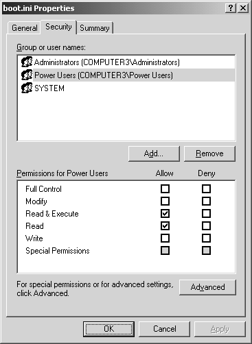

*Figure 1-9: Using Explorer to view the Boot.ini file’s ACL*

<!-- Source: Implementing.Security.for.Applications-2005-1-3.pdf, PDF page 4. -->

ACLs control a user’s access to system resources, and privileges control a user’s access to important system APIs. For example, only users with the SeShutdownPrivilege are allowed to turn the computer off. If your application turns the computer off, the user running the application must have that privilege or the .NET Framework throws an exception. Members of the Administrators group do have this privilege by default, but Users on computers running Windows Server 2003 lack this privilege. However, this does not mean that users must be members of the Administrators group to run an application that shuts down the computer—it means that users must be granted SeShutdownPrivilege to run the application. Understanding the distinction is important: group memberships can be used to grant privileges, but privileges can also be granted directly to users and groups without changing group memberships.

Controlling user privileges is a task best left to the system administrator responsible for managing your application. However, it is the developer’s responsibility to inform

<!-- Section 3, PDF page 5 -->

system administrators what privileges and ACLs must be modified to allow a standard user to run an application. You can examine and edit privileges on the local computer by following this process:

1. Log on to your computer as an administrator.

2. Click Start, click Administrative Tools, and then click Local Security Policy.

3. Expand Local Policies, and then click User Rights Assignment.

The Local Security Settings console

displays a list of all user rights assignments in the right pane, as shown in Figure 1-10.

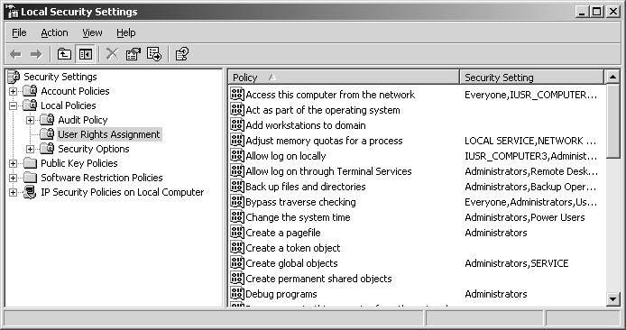

*Figure 1-10: The Local Security Settings console displaying user rights assignments*

<!-- Source: Implementing.Security.for.Applications-2005-1-3.pdf, PDF page 5. -->

4. In the right pane, double-click any policy to examine or edit the memberships.

See Also For information about programmatically controlling ACLs, see Chapter 4. For information about programmatically examining user privileges, see Chapter 5.

An alternative to adjusting ACLs and privileges is to prompt the user for administrators’ credentials when additional privileges are required, and use impersonation to temporarily gain elevated rights while running code that requires higher privileges than a standard user has. Although providing administrator credentials would be too cumbersome for tasks that users performed constantly, impersonation is useful when building rarely used management functions.

For example, consider a human resources application that is typically used by standard users but that requires elevated privileges when new user accounts are added. When a new employee is added, your application should prompt the user for credentials that show permission to add users immediately before creating the user account. If an

<!-- Section 3, PDF page 6 -->

attacker accesses the application while it is running as a standard user, the attacker will be prevented from creating a new user account—often one of the first tasks an attacker will attempt.

See Also For more information about impersonating users, see Chapter 9, “Hardening ASP .NET Applications.”

### The Process of Isolating Missing Privileges

Fortunately, Windows 2000, Windows XP, and Windows Server 2003 each include auditing capabilities that add an event to the Security event log each time a resource is accessed with insufficient permissions. Identifying the source of authorization problems using auditing is complex, but auditing will identify insufficient privileges that would be nearly impossible to find debugging code line by line. The flow chart in Figure 1-11 shows the authorization troubleshooting process that occurs when you use auditing.

Off the Record Most people think of auditing as solely an intrusion detection mechanism. In reality, its usefulness for intrusion detection is limited because it tends to generate far too many events to successfully parse. However, it is immensely useful when troubleshooting authorization problems.

Most of the troubleshooting process is self-explanatory, but enabling system auditing, enabling resource auditing, and analyzing events by using Event Viewer deserve further explanation.

<!-- Section 3, PDF page 7 -->

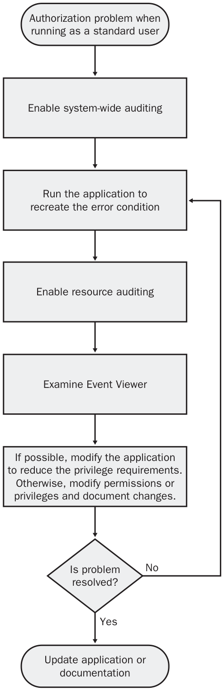

*Figure 1-11: Using auditing to identify authorization problems*

<!-- Source: Implementing.Security.for.Applications-2005-1-3.pdf, PDF page 7. -->

<!-- Section 3, PDF page 8 -->

### How to Enable System Auditing

The first step in identifying resources with insufficient privileges is to enable auditing on a system-wide basis:

1. Log on to your computer using an administrator account.

2. Click Start, and then click Administrative Tools. If this is a domain member or a stand-alone computer, click Local Security Policy. If this is a domain controller, click Domain Controller Security Policy.

3. Expand Local Policies, and then click Audit Policy.

4. If you are troubleshooting access to Active Directory objects, double-click Audit Directory Service Access. If you are troubleshooting access to any other type of object, double-click Audit Object Access.

5. Make note of the current setting. You will return this setting to its original state after you complete the troubleshooting process.

6. Select Define These Policy Settings, and then select Failure, as shown in Figure 112. Click OK.

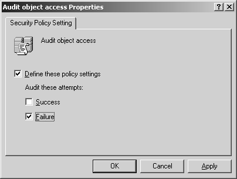

*Figure 1-12: Enabling auditing*

<!-- Source: Implementing.Security.for.Applications-2005-1-3.pdf, PDF page 8. -->

### How to Enable Resource Auditing

After enabling failure auditing for the Audit Object Access or Audit Directory Services Access policies, you must enable auditing for the individual resources that are being accessed. The exact process varies depending on the type of object you want to audit. The following process applies to enabling auditing for folders or files, the most common source of authorization problems. The process for auditing other types of objects is very similar, although you will use a different tool for each object.

<!-- Section 3, PDF page 9 -->

1. Click Start, point to All Programs, point to Accessories, and then click Windows Explorer.

2. Navigate to the file or folder you want to audit. If you are not sure which object is being accessed, you can enable auditing for entire disks.

3. Right-click the file or folder, and then click Properties.

Tip If you were auditing the registry, you would open the Registry Editor, right-click the registry key, and then select Permissions.

4. On the Security tab, click the Advanced button.

5. In the Advanced Security Settings dialog box, click the Auditing tab. Make note of the current settings, and then click Add.

6. In the Select User Or Group dialog box, type the name of the user account you are using to debug the application, and then click OK. The Auditing Entry dialog box appears.

7. Select the Failed check box for the Full Control entry, as shown in Figure 1-13. All Failed check boxes will be automatically selected.

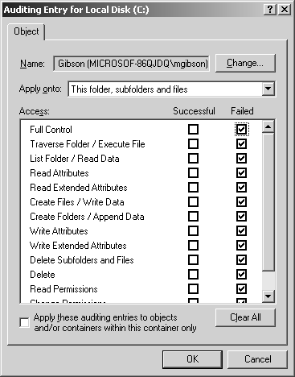

*Figure 1-13: Enabling resource failure auditing*

<!-- Source: Implementing.Security.for.Applications-2005-1-3.pdf, PDF page 9. -->

8. Click OK twice. Windows will apply the auditing setting to the folder, subfolder, and files automatically. If you are applying access to a large number of files, such as the entire C drive, this can take a moment.

9. Click OK to close the properties dialog box and return to Windows Explorer.

Now that failure auditing is enabled for those resources, every time the specified user is denied access to the resource, Windows will add an event to the security event log.

<!-- Section 3, PDF page 10 -->

### How to Analyze Events in Event Viewer

After you enable auditing and re-create the problem condition, Windows adds events to the Security event log that describe which resource could not be accessed and the type of operation that was attempted. To view failure audit events by using Event Viewer:

1. Log on to your computer using an administrator account.

2. Click Start, click Administrative Tools, and then click Event Viewer.

3. In the left pane, click Security. The Security event log will be displayed.

4. On the View menu, click Filter. The Security Properties dialog box appears.

5. Clear the Information, Warning, Error, and Success Audit check boxes. Only the Failure Audit check box should remain selected. Click OK.

6. Event Viewer will now display only failure audits in the right pane. Double-click the most recent failure audit to examine the contents of the event. The Event Properties dialog box appears, as shown in Figure 1-14.

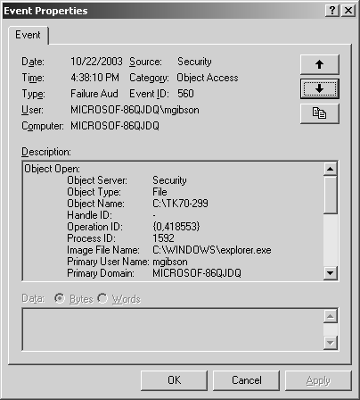

*Figure 1-14: Analyzing security events with Event Viewer*

<!-- Source: Implementing.Security.for.Applications-2005-1-3.pdf, PDF page 10. -->

7. Examine the Description box. This box shows the type of object, the object name, the process ID and image filename of the application used to access the object, and the type of operation that was performed on the object. For example, the following are the contents of the Description box for a user, mgibson, who was denied access to the C:\TK70-330 folder when she attempted to access the folder using Windows Explorer.

<!-- Section 3, PDF page 11 -->

```text
Object Open:
              Object Server:Security
              Object Type:File
              Object Name:C:\TK70-330
              Handle ID:-
              Operation ID:{0,419122}
              Process ID:1592
              Image File Name:C:\WINDOWS\explorer.exe
              Primary User Name:mgibson
              Primary Domain:MICROSOF-86QJDQ
              Primary Logon ID:(0x0,0x60641)
              Client User Name:-
              Client Domain:-
              Client Logon ID:-
              Accesses:SYNCHRONIZE
             ReadData (or ListDirectory)
             Privileges:-
              Restricted Sid Count:0
              Access Mask:0x100001
```

Notice that the Accesses line lists Synchronize and ReadData. This indicates that the application was attempting to gain read access to the C:\TK70-330 directory. To resolve this problem, you would either modify the application so that it no longer requires the right to read the directory, or you would document the fact that system administrators deploying your application need to make one of the following changes:

❑ Modify the folder’s ACL to grant the user (or a group to which the user belongs) read access to that folder.

❑ Add the user to a group that already has read access to the folder.

8. Browse through other failure audit events to determine other resources to which the user might require access.

After identifying the resources the user requires access to and assigning new permissions, repeat the troubleshooting process by re-creating the problem.

### Practice: Updating an Application to Use Least Privilege

In this practice, you will test a simple application as both an administrator and a standard user account. You will then debug any problems accessing resources as a standard user. Complete Exercises 1 through 3 and then answer the questions in Exercise 4.

### Exercise 1: Running Code as an Administrator

In this exercise, you will test a simple application to determine whether it is capable of running using the Administrator account.

1. Use the Administrator user account to log on to your test computer.

2. Use Windows Explorer to copy the MostPrivileges folder and its contents to the C:\Program Files\MostPrivileges\ folder on your test computer.

<!-- Section 3, PDF page 12 -->

3. In Windows Explorer, select the C:\Program Files\MostPrivileges\ folder, and then double-click MostPrivileges.csproj.

Visual Studio .NET 2003 will open the project.

4. On the Standard toolbar, verify that the Release configuration is selected. Click the Debug menu, and then click Start Without Debugging.

Visual Studio will compile and launch the application, which will display the contents of your Hosts file, as shown in Figure 1-15.

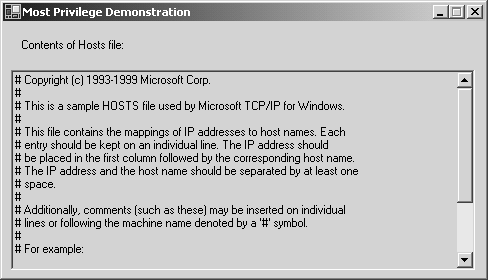

*Figure 1-15: MostPrivileges running successfully*

<!-- Source: Implementing.Security.for.Applications-2005-1-3.pdf, PDF page 12. -->

5. Close MostPrivileges, and then close Visual Studio. Remain logged on as Administrator.

### Exercise 2: Running Code as a User

In this exercise, you will test a simple application to determine whether it is capable of running using a standard user account.

1. While logged on as Administrator, click Start, click Administrative Tools, and then click Computer Management.

2. Expand Local Users And Groups, and then click Users.

3. Right-click Users, and then click New User.

4. In the User Name box, type Regular User.

5. In the Password and Confirm Password boxes, type a complex password.

6. Clear the User Must Change Password At Next Logon check box, and then click Create.

7. Click Close, and then close the Computer Management console.

8. Log off Windows.

9. Log on to your test computer with the Regular User account you created.

<!-- Section 3, PDF page 13 -->

10. Use Windows Explorer to navigate to the folder C:\Program Files\MostPrivi- leges\bin\Release. Double-click MostPrivileges.exe.

The MostPrivileges application launches and shows an error message, as shown in Figure 1-16.

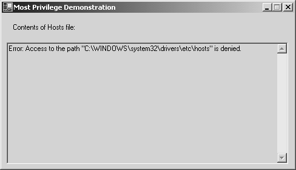

*Figure 1-16: MostPrivileges without sufficient permissions*

<!-- Source: Implementing.Security.for.Applications-2005-1-3.pdf, PDF page 13. -->

11. Use Windows Explorer to navigate to the folder C:\Windows\System32\Drivers \Etc.

12. Right-click Hosts, and then click Properties.

13. Click the Security tab.

As shown in Figure 1-17, the Users group has only Read and Read & Execute permissions to the Hosts file. This should be enough for the MostPrivileges application to run correctly, however, because the application displays only the contents of the file.

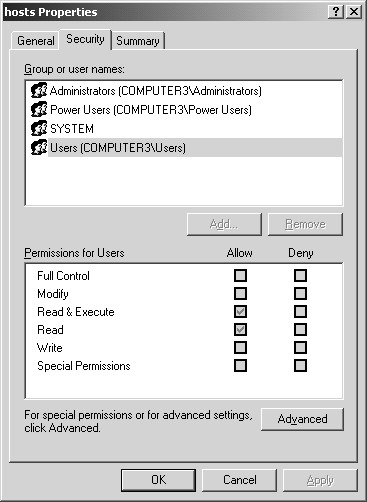

*Figure 1-17: Default permissions assigned to the Hosts file*

<!-- Source: Implementing.Security.for.Applications-2005-1-3.pdf, PDF page 13. -->

14. Click OK, and then log off Windows.

<!-- Section 3, PDF page 14 -->

### Exercise 3: Updating the Application to Use Least Privilege

In this exercise, you will update the sample application so that it uses least privilege and will run while logged on as a standard user. Then, you will test it to verify that it runs correctly.

1. Use the Administrator user account to log on to your test computer.

2. In Windows Explorer, select the C:\Program Files\MostPrivileges\ folder, and then double-click MostPrivileges.csproj.

Visual Studio .NET 2003 will open the project.

3. Modify line 36 so that the file is opened with only the Read file access method.

Before modification, the line reads:

```text
FileStream hostsFile=File.Open(hostsPath,FileMode.Open,FileAccess.ReadWrite);
```

Using FileAccess.ReadWrite allows the application to both read and write to the file as needed. This permission might occasionally be required. However, since this application only displays the contents of the Hosts file, it is unnecessary to request both read and write access. Modify the line so that it requests only read access. After modification, the line should read:

```text
FileStream hostsFile = File.Open(hostsPath, FileMode.Open, FileAccess.Read);
```

Design As you probably noticed, this application does not use the most efficient method for reading a text file. In fact, I had to go to great lengths to request excess access for this demonstration. The structure of the .NET Framework encourages developers to use least privilege.

4. Click the Build menu, and then click Build Solution.

5. Log off Windows.

6. Log on to your test computer with the Regular User account you created.

7. Use Windows Explorer to navigate to the folder C:\Program Files\MostPrivi- leges\bin\Release. Double-click MostPrivileges.exe.

The MostPrivileges application launches and shows the contents of the Hosts file. This version of the application runs correctly because the application requests read access to the Hosts file, and members of the Users group have the Read permission. The previous version did not work because the application requested both read and write access. Even though the application did not attempt to write to the file, the .NET Framework generated an exception when the application requested access.

<!-- Section 3, PDF page 15 -->

Security Alert The fact that administrators have access to edit the Hosts file is an excellent reason to not log on as an administrator. If you were to unknowingly run a virus or Trojan horse while logged on as an administrator, the malicious software could modify your Hosts file without your knowledge. Modifications to the Hosts file override DNS lookups by any application. Therefore, the malicious software can perform a man-in-the-middle attack by adding an entry to your Hosts file with the host name of a legitimate server and the IP address of a malicious server. The next time you attempted to initiate a connection to your server, your traffic would be sent to the malicious IP address. For example, adding the following line to your Hosts file would redirect all traffic destined for www.microsoft.com to 192.168.1.100:

```text
192.168.1.100 www.microsoft.com
```

### Exercise 4: Reflecting on Updating an Application to Use Least Privilege

Answer the following questions. If you are unable to answer a question, review the lesson materials and try the question again. You can find answers to the questions in the “Questions and Answers” section at the end of this chapter.

1. In Exercises 1 through 3, you explored an application that did not work correctly when the user was logged on as an administrator. Besides modifying the application, how else could you have resolved the problem? What drawbacks would that approach have?

2. Least privilege provides which of the following benefits? (Choose the best answer.)

a. Enables standard users to debug your application line by line

b. Grants standard users access to the Security event log

c. Allows your application to run with minimal privileges

d. Provides standard users access to the .NET Framework

### Lesson Summary

- Develop applications using a standard user account to identify resources and privileges your application requires that standard users lack access to.

- If your application requires more privileges than provided by the standard user account, you can either provide system administrators deploying your application with instructions to modify ACLs and grant additional privileges, or give administrators the option of automatically performing those changes during the setup process.

- Use auditing and the Event Viewer to identify required privileges that a user lacks.
