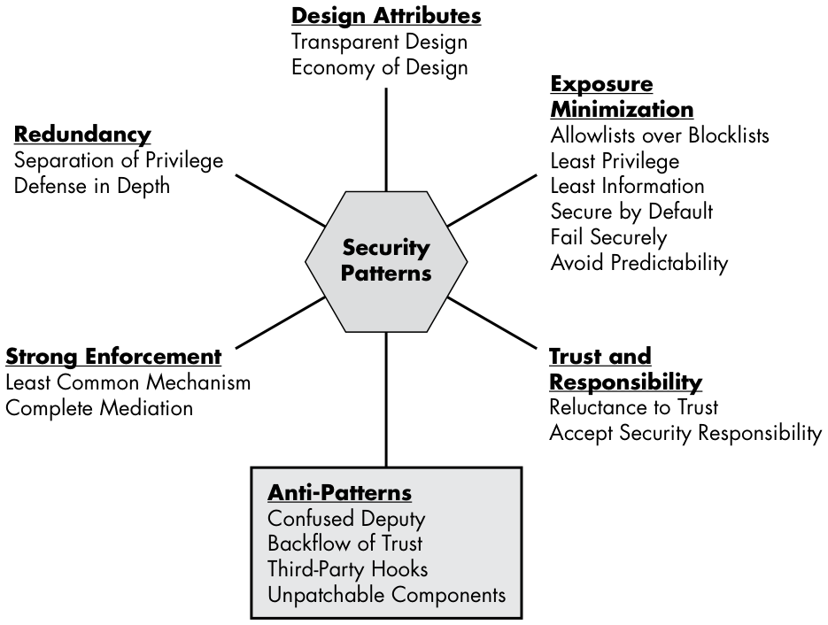
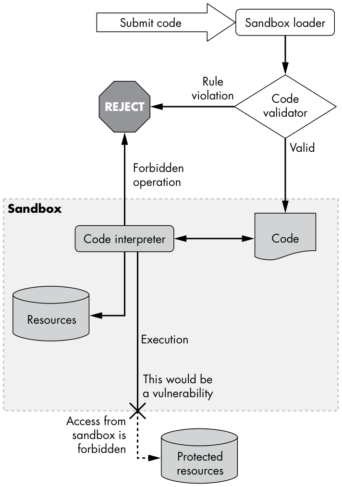
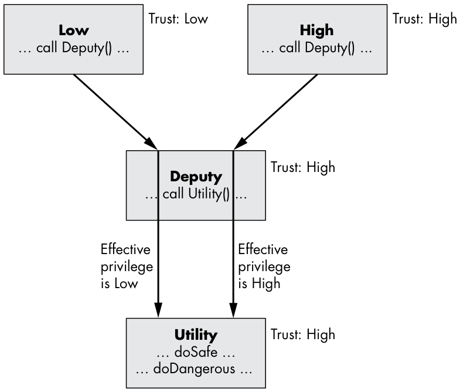

# Chapter 4 - Patterns

*Figure 4-4: Chapter-opening artwork*

<!-- Source: Designing.Secure.Software-2021-4.pdf, PDF page 1. -->

> _Art is pattern informed by sensibility._

—Herbert Read

Architects have long used design patterns to envision new buildings, an approach just as useful for guiding software design. This chapter introduces many of the most useful patterns promoting secure design. Several of these patterns derive from ancient wisdom; the trick is knowing how to apply them to software and how they enhance security.

These patterns either mitigate or avoid various security vulnerabilities, forming an important toolbox to address potential threats. Many are simple, but others are harder to understand and best explained by example. Don’t underestimate the simpler ones, as they can be widely applicable and are among the most effective. Still, other concepts may be easier to grasp as anti-patterns describing what not to do. I present these patterns in groups based on shared characteristics that you can think of as sections of the toolbox.

*Figure 4-1: Groupings of secure software patterns this chapter covers*

<!-- Source: Designing.Secure.Software-2021-4.pdf, PDF page 2. -->

When and where to apply these patterns requires judgment. Let necessity and simplicity guide your design decisions. As powerful as these patterns are, don’t overdo it; just as you don’t need seven deadbolts and chains on your doors, you don’t need to apply every possible design pattern to fix a problem. Where several patterns are applicable, choose the best one or two, or maybe more for critical security demands. Overuse can be counterproductive because the diminishing returns of increased complexity and overhead quickly outweigh additional security gains.

### Design Attributes

The first group of patterns describe at a high level what secure design looks like: simple and transparent. These derive from the adages “keep it simple” and “you should have nothing to hide.” As basic and perhaps obvious as these patterns may be, they can be applied widely and are very powerful.

### Economy of Design

Designs should be as simple as possible.

Economy of Design raises the security bar because simpler designs likely have fewer bugs, and thus fewer undetected vulnerabilities. Though developers claim that “all software has bugs,” we know that simple programs certainly can be bug-free. Prefer the simplest of competing designs for security mechanisms, and be wary of complicated designs that perform critical security functions.

LEGO bricks are a great example of this pattern. Once the design and manufacture of the standard building element is perfected, it enables building a countless array of creative designs. A similar system composed of a number of less universally useful pieces would be more difficult to build with; any particular design would require a larger inventory of parts and involve other technical challenges.

You can find many examples of Economy of Design in the system architecture of large web services built to run in massive datacenters. For reliability at scale, these designs decompose functionality into smaller, selfcontained components that collectively perform complicated operations. Often, a basic frontend terminates the HTTPS request, parsing and validating the incoming data into an internal data structure. That data structure gets sent on for processing by a number of subservices, which in turn use microservices to perform various functions.

In the case of an application such as web search, different machines may independently build different parts of the response in parallel, then yet another machine blends them into the complete response. It’s much easier to build many small services to do separate parts of the whole task—query parsing, spelling correction, text search, image search, results ranking, and page layout—than to do everything in one massive program.

Economy of Design is not an absolute mandate that everything must always be simple. Rather, it highlights the great advantages of simplicity, and says that you should only embrace complexity when it adds significant value. Consider the differences between the design of access control lists (ACLs) in *nix and Windows. The former is simple, specifying read/write/ execute permissions by user or user group, or for everybody. The latter is much more involved, including an arbitrary number of both allow and deny access control entries as well as an inheritance feature; notably, evaluation is dependent on the ordering of entries within the list. (These simplified descriptions are to make a point about design, and are not intended as complete.) This pattern correctly shows that the simpler *nix permissions are easier to correctly enforce, and beyond that, it’s easier for users of the system to correctly understand how ACLs work and therefore to use them correctly. However, if the Windows ACL provides just the right protection for a given application and can be accurately configured, then it may be a fine solution.

The Economy of Design pattern does not say that the simpler option is unequivocally better, or that the more complex one is necessarily problematic. In this example, *nix ACLs are not inherently better, and Windows ACLs are not necessarily buggy. However, Windows ACLs do represent more of a learning curve for developers and users, and using their more complicated features can easily confuse people as well as invite unintended consequences. The key design choice here, which I will not weigh in on, is to what extent the ACL designs best fit the needs of users. Perhaps *nix ACLs are too simplistic and fail to meet real demands; on the other hand, perhaps Windows ACLs are overly feature-bound and cumbersome in typical use patterns. These are difficult questions we must each answer for our own purposes, but for which this design pattern provides insight.

### Transparent Design

Strong protection should never rely on secrecy.

Perhaps the most famous example of a design that failed to follow the pattern of Transparent Design is the Death Star in Star Wars, whose thermal exhaust port afforded a straight shot at the heart of the battle station. Had Darth Vader held his architects accountable to this principle as severely as he did Admiral Motti, the story would have turned out very differently. Revealing the design of a well-built system should have the effect of dissuading attackers by showing its invincibility. It shouldn’t make the task easier for them. The corresponding anti-pattern may be better known: we call it Security by Obscurity.

This pattern specifically warns against a reliance on the secrecy of a design. It doesn’t mean that publicly disclosing designs is mandatory, or that there is anything wrong with secret information. If full transparency about a design weakens it, you should fix the design, not rely on keeping it secret. This in no way applies to legitimately secret information, such as cryptographic keys or user identities, which actually would compromise security if leaked. That’s why the name of the pattern is Transparent Design, not Absolute Transparency. Full disclosure of the design of an encryption method—the key size, message format, cryptographic algorithms, and so forth—shouldn’t weaken security at all. The anti-pattern should be a big red flag: for instance, distrust any self-anointed “experts” who claim to invent amazing encryption algorithms that are so great that they cannot publish the details. Without exception, these are bogus.

The problem with Security by Obscurity is that while it may help forestall adversaries temporarily, it’s extremely fragile. For example, imagine that a design used an outdated cryptographic algorithm: if the attackers ever found out that the software was still using, say, DES (a legacy symmetric encryption algorithm from the 1970s), they could easily crack it within a day. Instead, do the work necessary to get to a solid security footing so that there is nothing to hide, whether or not the design details are public.

### Exposure Minimization

The largest group of patterns call for caution: think “err on the safe side.” These are expressions of basic risk/reward strategies where you play it safe unless there is an important reason to do otherwise.

### Least Privilege

It’s always safest to use just enough privilege for the job.

Never clean a loaded gun. Unplug power saws when changing blades. These commonplace safety practices are examples of the Least Privilege pattern, which aims to reduce the risk of making mistakes when performing a task. This pattern is the reason that administrators of important systems should not be randomly browsing the internet while logged in at work; if they visit a malicious website and get compromised, the attack could easily do serious harm.

The *nix `sudo(1)` command performs exactly this purpose. User accounts with high privilege (known as sudoers) need to be careful not to inadvertently use their extraordinary power by accident or if compromised. To provide this protection, the user must prefix superuser commands with `sudo`, which may prompt the user for a password, in order to run them. Under this system, most commands (those that do not require `sudo`) will affect only the user’s own account, and cannot impact the entire system. This is akin to the “IN CASE OF EMERGENCY BREAK GLASS” cover on a fire alarm switch to prevent accidental activation, in that this forces an explicit step (corresponding to the `sudo` prefix) before activating the switch. With the glass cover, nobody can claim to have accidentally pulled the fire alarm, just as a competent administrator would never type `sudo` and a command that breaks the system all by accident.

This pattern is important for the simple reason that when vulnerabilities are exploited, it’s better for the attacker to have minimal privileges to use as leverage. Use all-powerful authorizations such as superuser privileges only when strictly necessary, and for the minimum possible duration. Even Superman practiced Least Privilege by only wearing his uniform when there was a job to do, and then, after saving the world, immediately changing back into his Clark Kent persona.

In practice, it does take more effort to selectively and sparingly use elevated privileges. Just as unplugging power tools to work on them requires more effort, discretion when using permissions requires discipline, but doing it right is always safer. In the case of an exploit, it means the difference between a minor incursion and total system compromise. Practicing Least Privilege can also mitigate damage done by bugs and human error.

Like all rules of thumb, use this pattern with a sense of balance to avoid overcomplication. Least Privilege does not mean the system should always grant literally the minimum level of authorization (for instance, creating code that, in order to write file X, is given write access to only that one file). You may wonder, why not always apply this excellent pattern to the max? In addition to maintaining a general sense of balance and recognizing diminishing returns for any mitigation, a big factor here is the granularity of the mechanism that controls authorization, and the cost incurred while adjusting privileges up and down. For instance, in a *nix process, permissions are conferred based on user and group ID access control lists. Beyond the flexibility of changing between effective and real IDs (which is what `sudo` does), there is no easy way to temporarily drop unneeded privileges without forking a process. Code should operate with lower ambient privileges where it can, using higher privileges in the necessary sections and transitioning at natural decision points.

### Least Information

It’s always safest to collect and access the minimum amount of private information needed for the job.

The Least Information pattern, the data privacy analog of Least Privilege, helps to minimize unintended disclosure risks. Avoid providing more private information than necessary when calling a subroutine, requesting a service, or responding to a request, and at every opportunity curtail unnecessary information flow. Implementing this pattern can be challenging in practice because software tends to pass data around in standard containers not optimized for purpose, so extra data often is included that isn’t really needed.

All too often, software fails this pattern because the design of interfaces evolves over time to serve a number of purposes, and it’s convenient to reuse the same parameters or data structure for consistency. As a result, data that isn’t strictly necessary gets sent along as extra baggage that seems harmless enough. The problem arises, of course, when this needless data flowing through the system creates additional opportunities for attack.

For example, imagine a large customer relationship management (CRM) system used by various workers in an enterprise. Different workers use the system for a wide variety of purposes, including sales, production, shipping, support, maintenance, R&amp;D, and accounting. Depending on their roles, each has a different authorization for access to subsets of this information. To practice Least Information, the applications in this enterprise should request only the minimum amount of data needed to perform a specific task. Consider a customer support representative responding to a phone call: if the system uses Caller ID to look up the customer record, the support person doesn’t need to know their phone number, just their purchase history. Contrast this with a more basic design that either allows or disallows the lookup of customer records that include all data fields. Ideally, even if the representative has more access, they should be able to request the minimum needed for a given task and work with that, thereby minimizing the risk of disclosure.

At the implementation level, Least Information design includes wiping locally cached information when no longer needed, or perhaps displaying a subset of available data on the screen until the user explicitly requests to see certain details. The common practice of displaying passwords as `********` uses this pattern to mitigate the risk of shoulder surfing. It’s particularly important to apply this pattern at design time, as it can be extremely difficult to implement later on because both sides of the interface need to change together. If you design independent components suited to specific tasks that require different sets of data, you’re more likely to get this right. APIs handling sensitive data should provide flexibility to allow callers to specify subsets of data they need in order to minimize information exposure (Table 4-1).

**Table 4-1: How Least Information Changes API Design**

| Least Information non-compliant API | Least Information compliant API |
| --- | --- |
| `RequestCustomerData(id='12345')` | `RequestCustomerData(id='12345', items=['name', 'zip'])` |
| `{'id': '12345', 'name': 'Jane Doe', 'phone': '888-555-1212', 'zip': '01010', ...}` | `{'name': 'Jane Doe', 'zip': '01010'}` |

The `RequestCustomerData` API in the left column ignores the Least Information pattern because the caller has no option but to request the complete data record by ID. They don’t need the phone number, so there is no need to request it, and even ignoring it still expands the attack surface for an attacker trying to get it. The right column has a version of the same API that allows callers to specify what fields they need and delivers only those, which minimizes the flow of private information.

Considering the Secure by Default pattern as well, the default for the `items` parameter should be a minimal set of fields, provided that callers can request exactly what they need to minimize information flow.

### Secure by Default

Software should always be secure “out of the box.”

Design your software to be Secure by Default, including in its initial state, so that inaction by the operator does not represent a risk. This applies to the overall system configuration, as well as configuration options for components and API parameters. Databases or routers with default passwords notoriously violate this pattern, and to this day, this design flaw remains surprisingly widespread.

If you are serious about security, never configure an insecure state with the intention of making it secure later, because this creates an interval of vulnerability and is too often forgotten. If you must use equipment with a default password, for example, first configure it safely on a private network behind a firewall before deploying it in the network. A pioneer in this area, the state of California has mandated this pattern by law; its Senate Bill No. 327 (2018) outlaws default passwords on connected devices.

Secure by Default applies to any setting or configuration that could have a detrimental security impact, not just to default passwords. Permissions should default to more restrictive settings; users should have to explicitly change them to less restrictive ones if needed, and only if it’s safe to do so. Disable all potentially dangerous options by default. Conversely, enable features that provide security protection by default so they are functioning from the start. And of course, keeping the software fully up-to-date is important; don’t start out with an old version (possibly one with known vulnerabilities) and hope that, at some point, it gets updated.

Ideally, you shouldn’t ever need to have insecure options. Carefully consider proposed configurable options, because it may be simple to provide an insecure option that will become a booby trap for others thereafter. Also remember that each new option increases the number of possible combinations, and the task of ensuring that all of those combinations of settings are actually useful and safe becomes more difficult as the number of options increases. Whenever you must provide unsafe configurations, make a point of proactively explaining the risk to the administrator.

Secure by Default applies much more broadly than to configuration options, though. Defaults for unspecified API parameters should be secure choices. A browser accepting a URL entered into the address bar without any protocol specified should assume the site uses HTTPS, and fall back to HTTP only if the former fails to connect. Two peers negotiating a new HTTPS connection should default to accepting the more secure cipher suite choices first.

### Allowlists over Blocklists

Prefer allowlists over blocklists when designing a security mechanism. Allowlists are enumerations of what’s safe, so they are inherently finite. By contrast, blocklists attempt to enumerate all that isn’t safe, and in doing so implicitly allow an infinite set of things you hope are safe. It’s clear which approach is riskier.

First, here’s a non-software example to make sure you understand what the allowlist versus blocklist alternative means, and why allowlists are always the way to go. During the early months of the COVID-19 stay-at-home emergency order, the governor of my state ordered the beaches closed with the following provisos, presented here in simplified form:

> No person shall sit, stand, lie down, lounge, sunbathe, or loiter on any beach except when “running, jogging, or walking on the beach, so long as social distancing requirements are maintained” (crossing the beach to surf is also allowed).

The first clause is a blocklist, because it lists what activities are not allowed, and the second exception clause is an allowlist, because it grants permission to the activities listed. Due to legal issues, there may well be good reasons for this language, but from a strictly logical perspective, I think it leaves much to be desired.

First let’s consider the blocklist: I’m confident that there are other risky activities people could do at the beach that the first clause fails to prohibit. If the intention of the order was to keep people moving, it omitted many— kneeling, for example, as well as yoga and living statue performances. The problem with blocklists is that any omissions become flaws, so unless you can completely enumerate every possible bad case, it’s an insecure system.

Now consider the allowlist of allowable beach activities. While it, too, is incomplete—who would contest that skipping is also fine?—this won’t cause a big security problem. Perhaps a fraction of a percent of beach skippers will be unfairly punished, but the harm is minor, and more importantly, an incomplete enumeration doesn’t open up a hole that allows a risky activity. Additional safe items initially omitted can easily be added to the allowlist as needed.

More generally, think of a continuum, ranging from disallowed on the left, then shading to allowed on the right. Somewhere in the middle is a dividing line. The goal is to allow the good stuff on the right of the line while disallowing the bad on the left. Allowlists draw the line from the right side, then gradually move it to the left, including more parts of the continuum as the list of what to allow grows. If you omit something good from the allowlist, you’re still on the safe side of the elusive line that’s the true divide. You may never get to the precise point that allows all safe actions, at which point any addition to the list would be too much, but using this technique makes it easy to stay on the safe side. Contrast that to the blocklist approach: unless you enumerate everything to the left of the true divide, you’re allowing something you shouldn’t. The safest blocklist will be one that includes just about everything, and that’s likely to be overly restrictive, so it doesn’t work well either way.

Often, the use of an allowlist is so glaringly obvious we don’t notice it as a pattern. For example, a bank would reasonably authorize a small set of trusted managers to approve high-value transactions. Nobody would dream of maintaining a blocklist of all the employees not authorized, tacitly allowing any other employee such privilege. Yet sloppy coders might attempt to do input validation by checking that the value did not contain any of a list of invalid characters, and in the process easily forget about characters like NUL (ASCII 0) or perhaps DEL (ASCII 127).

Ironically, perhaps the biggest-selling consumer security product, antivirus software, attempts to block all known malware. Modern antivirus products are much more sophisticated than the old-school versions, which relied on comparing a digest against a database of known malware, but still, they all appear to work based on a blocklist to some extent. (A great example of Security by Obscurity, most commercial antivirus software is proprietary, so we can only speculate.) It makes sense that they’re stuck with blocklist techniques because they know how to collect examples of malware, and the prospect of somehow allowlisting all good software in the world before it’s released seems to be a nonstarter. My point isn’t about any particular product or an assessment of its worth, but about the design choice of protection by virtue of a blocklist, and why that’s inevitably risky.

### Avoid Predictability

Any data (or behavior) that is predictable cannot be kept private, since attackers can learn it by guessing.

Predictability of data in software design can lead to serious flaws because it can result in the leakage of information. For instance, consider the simple example of assigning new customer account IDs. When a new customer signs up on a website, the system needs a unique ID to designate the account. One obvious and easy way to do this is to name the first account 1, the second account 2, and so on. This works, but from the point of view of an attacker, what does it give away?

New account IDs now provide an attacker an easy way of learning the number of user accounts created so far. For example, if the attacker periodically creates a new, throwaway account, they have an accurate metric for how many customer accounts the website has at a given time—information that most businesses would be loathe to disclose to a competitor. Many other pitfalls are possible, depending on the specifics of the system. Another consequence of this poor design is that attackers can easily guess the account ID assigned to the next new account created, and armed with this knowledge, they might be able to interfere with the new account setup by claiming to be the new account and confusing the registration system.

The problem of predictability takes many guises, and different types of leakage can occur with different designs. For example, an account ID that includes several letters of the account holder’s name or ZIP code would needlessly leak clues about the account owner’s identity. Of course, this same problem applies to IDs for web pages, events, and more. The simplest mitigation against these issues is that if the purpose of an ID is to be a unique handle, you should make it just that—never a count of users, the email of the user, or based on other identifying information.

The easy way to avoid these problems is to use securely random IDs. Truly random values cannot be guessed, so they do not leak information. (Strictly speaking, the length of IDs leaks the maximum number of possible IDs, but this usually isn’t sensitive information.) A standard system facility, random number generators come in two flavors: pseudorandom number generators and secure random number generators. You should use the secure option, which is slower, unless you’re certain that predictability is harmless.

### Fail Securely

If a problem occurs, be sure to end up in a secure state.

In the physical world, this pattern is common sense itself. An old-fashioned electric fuse is a great example: if too much current flows through it, the heat melts the metal, opening the circuit. The laws of physics make it impossible to fail in a way that maintains excessive current flow. This pattern perhaps may seem like the most obvious one, but software being what it is (we don’t have the laws of physics on our side), it’s easily disregarded.

Many software coding tasks that at first seem almost trivial often grow in complexity due to error handling. The normal program flow can be simple, but when a connection is broken, memory allocation fails, inputs are invalid, or any number of other potential problems arise, the code needs to proceed if possible, or back out gracefully if not. When writing code, you might feel as though you spend more time dealing with all these distractions than with the task at hand, and it’s easy to quickly dismiss error-handling code as unimportant, making this a common source of vulnerabilities. Attackers will intentionally trigger these error cases if they can, in hopes that there is a vulnerability they can exploit.

Error cases are often tedious to test thoroughly, especially when combinations of multiple errors can compound into new code paths, so this can be fertile ground for attack. Ensure that each error is either safely handled, or leads to full rejection of the request. For example, when someone uploads an image to a photo sharing service, immediately check that it is well formed (because malformed images are often used maliciously), and if not, then promptly remove the data from storage to prevent its further use.

### Strong Enforcement

These patterns concern how to ensure that code behaves by enforcing the rules thoroughly. Loopholes are the bane of any laws and regulations, so these patterns show how to avoid creating ways of gaming the system. Rather than write code and reason that you don’t think it will do something, it’s better to structurally design it so that forbidden operations cannot possibly occur.

### Complete Mediation

Protect all access paths, enforcing the same access, without exception.

An obscure term for an obvious idea, Complete Mediation means securely checking all accesses to a protected asset consistently. If there are multiple access methods to a resource, they must all be subject to the same authorization check, with no shortcuts that afford a free pass or looser policy.

For example, suppose a financial investment firm’s information system policy declares that regular employees cannot look up the tax IDs of customers without manager approval, so the system provides them with a reduced view of customer records omitting that field. Managers can access the full record, and in the rare instance that a non-manager has a legitimate need, they can ask a manager to look it up. Employees help customers in many ways, one of which is providing replacement tax documents if, for some reason, customers did not receive theirs in the mail. After confirming the customer’s identity, the employee requests a duplicate form (a PDF), which they print out and mail to the customer. The problem with this system is that the customer’s tax ID, which the employee should not have access to, appears on the tax form: that’s a failure of Complete Mediation. A dishonest employee could request any customer’s tax form, as if for a replacement, just to learn their tax ID, defeating the policy preventing disclosure to employees.

The best way to honor this pattern is, wherever possible, to have a single point where a particular security decision occurs. This is often known as a guard or, informally, a bottleneck. The idea is that all accesses to a given asset must go through one gate. Alternatively, if that is infeasible and multiple pathways need guards, then all checks for the same access should be functionally equivalent and ideally implemented as identical code.

In practice, this pattern can be challenging to accomplish consistently. There are different degrees of compliance, depending on the guards in place:

**High compliance**

Resource access only allowed via one common routine (bottleneck guard)

**Medium compliance**

Resource access in various places, each guarded by an identical authorization check (common multiple guards)

**Low compliance**

Resource access in various places, variously guarded by inconsistent authorization checks (incomplete mediation)

A counter-example demonstrates why designs with simple authorization policies that concentrate authorization checks in a single bottleneck code path for a given resource are the best way to get this pattern right. A Reddit user recently reported a case of how easy it is to get it wrong:

> I saw that my 8-year-old sister was on her iPhone 6 on iOS 12.4.6 using YouTube past her screen time limit. Turns out, she discovered a bug with screen time in messages that allows the user to use apps that are available in the iMessage App Store.

Apple designed iMessage to include its own apps, making it possible to invoke the YouTube app in multiple ways, but it didn’t implement the screen-time check on this alternate path to video watching—a classic failure of Complete Mediation.

Avoid having multiple paths for accessing the same resource, each with custom code that potentially works slightly differently, because any discrepancies could mean weaker guards on some paths than on others. Multiple guards would require implementing the same essential check multiple times, and would be more difficult to maintain because you’d need to make matching changes in several places. The use of multiple guards incurs more chances of making an error and more work to thoroughly test.

### Least Common Mechanism

Maintain isolation between independent processes by minimizing shared mechanisms.

To best appreciate what this means and how it helps, let’s consider an example. The kernel of a multiuser operating system manages system resources for processes running in different user contexts. The design of the kernel fundamentally ensures the isolation of processes unless they explicitly share a resource or a communication channel. Under the covers, the kernel maintains various data structures necessary to service requests from all user processes. This pattern points out that the common mechanism of these structures could inadvertently bridge processes, and therefore it’s best to minimize such opportunities. For example, if some functionality can be implemented in userland code, where the process boundary necessarily isolates it to the process, the functionality will be less likely to somehow bridge user processes. Here, the term bridge specifically means either leaking information, or allowing one process to influence another without authorization.

If that still feels abstract, consider this non-software analogy. You visit your accountant to review your tax return the day before the filing deadline. Piles of papers and folders cover the accountant’s desk like miniature skyscrapers. After shuffling through the chaotic mess, they pull out your paperwork and start the meeting. While waiting, you can see tax forms and bank statements with other people’s names and tax IDs in plain sight. Perhaps your accountant accidentally jots a quick note about your taxes in someone else’s file by mistake. This is exactly the kind of bridge between independent parties, created because the accountant uses the desktop as a common workspace, that the Least Common Mechanism strives to avoid.

Next year, you hire a different accountant, and when you meet with them, they pull your file out of a cabinet. They open it on their desk, which is neat, with no other clients’ paperwork in sight. That’s how to do Least Common Mechanism right, with minimal risk of mix-ups or nosy clients seeing other documents.

In the realm of software, apply this pattern by designing services that interface to independent processes or different users. Instead of a monolithic database with everyone’s data in it, can you provide each user with a separate database or otherwise scope access according to the context? There may be good reasons to put all the data in one place, but when you choose not to follow this pattern, be alert to the added risk and explicitly enforce the necessary separation. Web cookies are a great example of using this pattern because each client stores its own cookie data independently.

### Redundancy

_Redundancy_ is a core strategy for safety in engineering that’s reflected in many common-sense practices, such as spare tires for cars. These patterns show how to apply it to make software more secure.

### Defense in Depth

Combining independent layers of protection makes for a stronger overall defense that is often synergistically far more effective than any single layer.

This powerful technique is one of the most important patterns we have for making inevitably bug-ridden software systems more secure than their components. Visualize a room that you want to convert to a darkroom by putting plywood over the window. You have plenty of plywood, but somebody has randomly drilled several small holes in every sheet. Nail up just one sheet, and numerous pinholes ruin the darkness. Nail a second sheet on top of that, and unless two holes just happen to align, you now have a completely dark room. A security checkpoint that utilizes both a metal detector and a pat-down is another example of this pattern.

In the realm of software design, deploy _Defense in Depth_ by layering two or more independent protection mechanisms to enforce a particularly critical security decision. Like the holey plywood, there might be flaws in each of the implementations, but the likelihood that any given attack will penetrate both is minuscule, akin to having two plywood holes just happen to line up and let light through. Since two independent checks require double the effort and take twice as long, you should use this technique sparingly.

A great example of this technique that balances the effort and overhead against the benefit is the implementation of a _sandbox_, a container in which untrusted arbitrary code can run safely. (Modern web browsers run WebAssembly in a secure sandbox.) Running untrusted code in your system could have disastrous consequences if anything goes wrong, justifying the overhead of multiple layers of protection.

*Figure 4-2: An example of a sandbox as the Defense in Depth pattern*

<!-- Source: Designing.Secure.Software-2021-4.pdf, PDF page 14. -->

Code for sandbox execution first gets scanned by an analyzer (defense layer one), which examines it against a set of rules. If any violation occurs, the system rejects the code completely. For example, one rule might forbid the use of calls into the kernel; another rule might forbid the use of specific privileged machine instructions. If and only if the code passes the scanner, it then gets loaded into an interpreter that runs the code while also enforcing a number of restrictions intended to prevent the same kinds of overprivileged operations. For an attacker to break this system, they must first get past the scanner’s rule checking and also trick the interpreter into executing the forbidden operation. This example is especially effective because code scanning and interpretation are fundamentally different, so the chances of the same flaw appearing in both layers is low, especially if they’re developed independently. Even if there is a one-in-a-million chance that the scanner misses a particular attack technique, and the same goes for the interpreter, once they’re combined, the total system has about a one-ina-trillion chance of actually failing. That’s the power of this pattern.

### Separation of Privilege

Two parties are more trustworthy than one.

Also known as _Separation of Duty_, the _Separation of Privilege_ pattern refers to the indisputable fact that two locks are stronger than one when those locks have different keys entrusted to two different people. While it’s possible that those two people may be in cahoots, that rarely happens; plus, there are good ways to minimize that risk, and in any case it’s way better than relying entirely on one individual.

For example, safe deposit boxes are designed such that a bank maintains the security of the vault that contains all the boxes, and each box holder has a separate key that opens their box. Bankers cannot get into any of the boxes without brute-forcing them, such as by drilling the locks, yet no customer knows the combination that opens the vault. Only when a customer gains access from the bank and then uses their own key can their box be opened.

Apply this pattern when there are distinct overlapping responsibilities for a protected resource. Securing a datacenter is a classic case: the datacenter has a system administrator (or a team of them for a big operation) responsible for operating the machines with superuser access. In addition, security guards control physical access to the facility. These separate duties, paired with corresponding controls of the respective credentials and access keys, should belong to employees who report to different executives in the organization, making collusion less likely and preventing one boss from ordering an extraordinary action in violation of protocol. Specifically, the admins who work remotely shouldn’t have physical access to the machines in the datacenter, and the people physically in the datacenter shouldn’t know any of the access codes to log in to the machines, or the keys needed to decrypt any of the storage units. It would take two people colluding, one from each domain of control, to gain both physical and admin access in order to fully compromise security. In large organizations, different groups might be responsible for various datasets managed within the datacenter as an additional degree of separation.

The other use of this pattern, typically reserved for the most critical functions, is to split one responsibility into multiple duties to avoid any serious consequences as a result of a single actor’s mistake or malicious intent. As extra protection against a backup copy of data possibly leaking, you could encrypt it twice with different keys entrusted separately, so that it can be used only with the help of both parties. An extreme example, triggering a nuclear missile launch, requires two keys turned simultaneously in locks 10 feet apart, ensuring that no individual acting alone could possibly actuate it.

Secure your audit logs by Separation of Privilege, with one team responsible for the recording and reviewing of events and another for initiating the events. This means that the admins can audit user activity, but a separate group needs to audit the admins. Otherwise, a bad actor could block the recording of their own corrupt activity or tamper with the audit log to cover their tracks.

You can’t achieve Separation of Privilege within a single computer because an administrator with superuser rights has full control, but there are still many ways to approximate it to good effect. Implementing a design with multiple independent components can still be valuable as a mitigation, even though an administrator can ultimately defeat it, because it makes subversion more complicated; any attack will take longer and the attacker is more likely to make mistakes in the process, increasing their likelihood of being caught. Strong Separation of Privilege for administrators could be designed by forcing the admin to work via a special `ssh` gateway under separate control that logged their session in full detail and possibly imposed other restrictions.

Insider threats are difficult, or in some cases impossible, to eliminate, but that doesn’t mean mitigations are a waste of time. Simply knowing that somebody is watching is, in itself, a large deterrent. Such precautions are not just about distrust: honest staff should welcome any Separation of Privilege that adds accountability and reduces the risk posed by their own mistakes. Forcing a rogue insider to work hard to cleanly cover their tracks slows them down and raises the odds of their being caught red-handed. Fortunately, human beings have well-evolved trust systems for face-to-face encounters with coworkers, and as a result, insider duplicity is extremely rare in practice.

### Trust and Responsibility

Trust and responsibility are the glue that makes cooperation work. Software systems are increasingly interconnected and interdependent, so these patterns are important guideposts.

### Reluctance to Trust

Trust should be always be an explicit choice, informed by solid evidence.

This pattern acknowledges that trust is precious, and so urges skepticism. Before there was software, criminals exploited people’s natural inclination to trust others, dressing up as workmen to gain access, selling snake oil, or perpetrating an endless variety of other scams. Reluctance to Trust tells us not to assume that a person in a uniform is necessarily legit, and to consider that the caller who says they’re with the FBI may be a trickster. In software, this pattern applies to checking the authenticity of code before installing it, and requiring strong authentication before authorization.

The use of HTTP cookies is a great example of this pattern, as Chapter 11 explains in detail. Web servers set cookies in their response to the client, expecting clients to send back those cookies with future requests. But since clients are under no actual obligation to comply, servers should always take cookies with a grain of salt, and it’s a huge risk to absolutely trust that clients will always faithfully perform this task.

Reluctance to Trust is important even in the absence of malice. For example, in a critical system, it’s vital to ensure that all components are up to the same high standards of quality and security so as not to compromise the whole. Poor trust decisions, such using code from an anonymous developer (which might contain malware, or simply be buggy) for a critical function quickly undermines security. This pattern is straightforward and rational, yet can be challenging in practice because people are naturally trusting and it can feel paranoid to withhold trust.

### Accept Security Responsibility

All software professionals have a clear duty to take responsibility for security; they should reflect that attitude in the software they produce.

For example, a designer should include security requirements when vetting external components to incorporate into the system. And at the interface between two systems, both sides should explicitly take on certain responsibilities they will honor, as well as confirm any guarantees they depend on the caller to uphold.

The anti-pattern that you don’t want is to someday encounter a problem and have two developers say to each other, “I thought you were handling security, so I didn’t have to.” In a large system, both sides can easily find themselves pointing the finger at the other. Consider a situation where component A accepts untrusted input (for example, a web frontend server receiving an anonymous internet request) and passes it through, possibly with some processing or reformatting, to business logic in component B. Component A could take no security responsibility at all and blindly pass through all inputs, assuming B will handle the untrusted input safely with suitable validation and error checking. From component B’s perspective, it’s easy to assume that the frontend validates all requests and only passes safe requests on to B, so there is no need for B to worry about this. The right way to handle this situation is by explicit agreement; decide who validates requests and what guarantees to provide downstream, if any. For maximum safety, use Defense in Depth, where both components independently validate the input.

Consider another all-too-common case, where the responsibility gap occurs between the designer and user of the software. Recall the example of configuration settings from our discussion of the Secure by Default pattern, specifically when an insecure option is given. If the designer knows a configurable option to be less secure, they should carefully consider whether providing that option is truly necessary. That is, don’t just give users an option because it’s easy to do, or because “someone, someday, might want this.” That’s tantamount to setting a trap that someone will eventually fall into unwittingly. When valid reasons for a potentially risky configuration exist, first consider methods of changing the design to allow a safe way of solving the problem. Barring that, if the requirement is inherently unsafe, the designer should advise the user and protect them from configuring the option when unaware of the consequences. Not only is it important to document the risks and suggest possible mitigations to offset the vulnerability, but users should also receive clear feedback—ideally, something better than the responsibility-ditching “Are you sure? (Learn more: &lt;link&gt;)” dialog.

### Patterns

This author personally considers “Are you sure?” dialogs and their ilk to almost always be a failure of design, and one that also often compromises security. I have yet to come across an example in which such a dialog is the best possible solution to the problem. When there are security consequences, this practice runs afoul of the Accept Security Responsibility pattern, in that the designer is foisting responsibility on to the user, who may well not be “sure” but has run out of options. To be clear, in these remarks I would not include normal confirmations, such as `rm(1)` command interactive prompts or other operations where it’s important to avoid accidental operation.

These dialogs can fall victim to the dialog fatigue phenomenon, in which people trying to get something done reflexively dismiss dialogs, almost universally considering them hindrances rather than help. As security conscious as I am, when presented with these dialogs I, too, wonder, “How else can I do what I want to do?” My choices are to either give up on what I want to do or proceed at my own considerable risk—and I can only guess at exactly what that risk is, since even if there is a “learn more” text provided, it never seems to provide a good solution. At this point, “Are you sure?” only signals to me that I’m about to do something I’ll potentially regret, without explaining exactly what might happen and implying there likely is no going back.

I’d like to see a new third option added to these dialogs—“No, I’m not sure but proceed anyway”—and have that logged as a severe error because the software has failed the user. For any situation where security is critical, scrutinize examples of this sort of responsibility offloading and treat them as significant bugs to be eventually resolved. Exactly how to eliminate these will depend on the particulars, but there are some general approaches to accepting responsibility. Be clear as to precisely what is about to happen and why. Keep the wording concise, but provide a link or equivalent reference to a complete explanation and good documentation. Avoid vague wording (“Are you sure you want to do this?”) and show exactly what the target of the action will be (don’t let the dialog box obscure important information). Never use double negatives or confusing phrasing (“Are you sure you want to go back?” where answering “No” selects the action). If possible, provide an undo option; a good pattern, seen more these days, is passively offering an undo following any major action. If there is no way to undo, then in the linked documentation, offer a workaround, or suggest backing up data beforehand if unsure. Let’s strive to reduce these Hobson’s choices in quantity, and ideally confine them to use by professional administrators who have the know-how to accept responsibility.

### Anti-Patterns

> _Learn to see in another’s calamity the ills which you should avoid._

—Publilius Syrus

Some skills are best learned by observing how a master works, but another important kind of learning comes from avoiding the past mistakes of others. Beginning chemists learn to always dilute acid by adding the acid to a container of water—never the reverse, because in the presence of a large amount of acid, the first drop of water reacts suddenly, producing a lot of heat that could instantly boil the water, expelling water and acid explosively. Nobody wants to learn this lesson by imitation, and in that spirit, I present here several anti-patterns best avoided in the interests of security.

The following short sections list a few software security anti-patterns. These patterns may generally carry security risks, so they are best avoided, but they are not actual vulnerabilities. In contrast to the named patterns covered in the previous sections, which are generally recognizable terms, some of these don’t have well-established names, so I have chosen descriptive monikers here for convenience.

### Confused Deputy

The _Confused Deputy_ problem is a fundamental security challenge that is at the core of many software vulnerabilities. One could say that this is the mother of all anti-patterns. To explain the name and what it means, a short story is a good starting point. Suppose a judge issues a warrant, instructing their deputy to arrest Norman Bates. The deputy looks up Norman’s address, and arrests the man living there. The man insists there is a mistake, but the deputy has heard that excuse before. The plot twist of our story (which has nothing to do with _Psycho_) is that Norman anticipated getting caught and for years has used a false address. The deputy, confused by this subterfuge, used their arrest authority wrongly; you could say that Norman played them, managing to direct the deputy’s duly granted authority to his own malevolent purposes. (The despicable crime of swatting— falsely reporting an emergency to direct police forces against innocent victims—is a perfect example of the Confused Deputy problem, but I didn’t want to tell one of those sad stories in detail.)

Common examples of confused deputies include the kernel when called by userland code, or a web server when invoked from the internet. The callee is a _deputy_ because the higher-privilege code is invoked to do things on behalf of the lower-privilege caller. This risk derives directly from the trust boundary crossing, which is why those are of such acute interest in threat modeling. In later chapters, numerous ways of confusing a deputy will be covered, including buffer overflows, poor input validation, and cross-site request forgery (CSRF) attacks, just to name a few. Unlike human deputies, who can rely on instinct, past experience, and other cues (including common sense), software is trivially tricked into doing things it wasn’t intended to, unless it’s designed and implemented with all necessary precautions fully anticipated.

### Intention and Malice

To recap, for software to be trustworthy, there are two requirements: it must be built by people you can trust are both honest and competent to deliver a quality product. The difference between the two conditions is intention. The problem with arresting Norman Bates wasn’t that the deputy was crooked; it was failing to properly ID the arrestee. Of course, code doesn’t disobey or get lazy, but poorly-written code can easily work in ways other than how it was intended. While many gullible computer users and occasionally even technically adept software professionals do get tricked into trusting malicious software, many attacks work by exploiting a Confused Deputy in software that is duly trusted but happens to be flawed.

Often, Confused Deputy vulnerabilities arise when the context of the original request gets lost earlier in the code—for example, if the requester’s identity is no longer available. This sort of confusion is especially likely in common code shared by both high- and low-privilege invocations. Figure 4-3 shows what such an invocation looks like.

*Figure 4-3: An example of the Confused Deputy anti-pattern*

<!-- Source: Designing.Secure.Software-2021-4.pdf, PDF page 20. -->

The `Deputy` code in the center performs work for both low- and high-privilege code. When invoked from High on the right, it may do potentially dangerous operations in service of its trusted caller. Invocation from Low represents a trust boundary crossing, so `Deputy` should only do safe operations appropriate for low-privilege callers. Within the implementation, `Deputy` uses a subcomponent, `Utility`, to do its work. Code within `Utility` has no notion of high- and low-privilege callers, and hence is liable to mistakenly do potentially dangerous operations on behalf of `Deputy` that low-privilege callers should not be able to do.

### Trustworthy Deputy

Let’s break down how to be a trustworthy deputy, beginning with a consideration of where the danger lies. Recall that trust boundaries are where the potential for confusion begins, because the goal in attacking a Confused Deputy is to leverage its higher privilege. So long as the deputy understands the request and who is requesting it, and the appropriate authorization checks happen, everything should be fine.

Recall the previous example involving the `Deputy` code, where the problem occurred in the underlying `Utility` code that did not contend with the trust boundary when called from Low. In a sense, `Deputy` unwittingly made `Utility` a Confused Deputy. If `Utility` was not intended to defend against low-privilege callers, then either `Deputy` needs to thoroughly shield it from being tricked, or `Utility` may require modification to be aware of low-privilege invocations.

Another common Confused Deputy failing occurs in the actions taken on behalf of the request. _Data hiding_ is a fundamental design pattern where the implementation hides the mechanisms it uses behind an abstraction, and the deputy works directly on the mechanism though the requester cannot. For example, the deputy might log information as a side effect of a request, but the requester has no access to the log. By causing the deputy to write the log, the requester is leveraging the deputy’s privilege, so it’s important to beware of unintended side effects. If the requester can present a malformed string to the deputy that flows into the log with the effect of damaging the data and making it illegible, that’s a Confused Deputy attack that effectively wipes the log. In this case, the defense begins by noting that a string from the requester can flow into the log and, considering the potential impact that might have, requiring input validation, for example.

The [Code Access Security](./chapter-03.md#narrow-windows-of-vulnerability) model, is designed specifically to prevent Confused Deputy vulnerabilities from arising. When low-privilege code calls high-privilege deputy code, the effective permissions are reduced accordingly. When the deputy needs its greater privileges, it must assert them explicitly, acknowledging that it is working at the behest of lower-privilege code.

In summary, at trust boundaries, handle lower-trust data and lower-privilege invocations with care so as not to become a Confused Deputy. Keep the context associated with requests throughout the process of performing the task so that authorization can be fully checked as needed. Beware that side effects do not allow requesters to exceed their authority.

### Backflow of Trust

Backflow of Trust is present whenever a lower-trust component controls a higher-trust component. An example of this is when a system administrator uses their personal computer to remotely administer an enterprise system. While the person is duly authorized and trusted, their home computer isn’t within the enterprise regime and shouldn’t be hosting sessions using admin rights. In essence, you can think of this as a structural Elevation of Privilege just waiting to happen.

While nobody in their right mind would fall into this anti-pattern in real life, it’s surprisingly easy to miss in an information system. Remember that what counts here is not the trust you give components, but how much trust the components merit. Threat modeling can surface potential problems of this variety through an explicit look at trust boundaries.

### Third-Party Hooks

Another form of the Backflow of Trust anti-pattern is when hooks in a component within your system provide a third party undue access. Consider a critical business system that includes a proprietary component performing some specialized process within the system. Perhaps it uses advanced AI to predict future business trends, consuming confidential sales metrics and updating forecasts daily. The AI component is cutting-edge, and so the company that makes it must tend to it daily. To make it work like a turnkey system, it needs a direct tunnel through the firewall to access the administrative interface.

This also is a perverse trust relationship because this third party has direct access into the heart of the enterprise system, completely outside the purview of the administrators. If the AI provider were dishonest, or compromised, they could easily exfiltrate internal company data, or worse, and there would be no way of knowing. Note that a limited type of hook may not have this problem and would be acceptable. For example, if the hook implements an auto-update mechanism and is only capable of downloading and installing new versions of the software, it may be fine, given a suitable level of trust.

### Unpatchable Components

It’s almost invariably a matter of when, not if, someone will discover a vulnerability in any given popular component. Once such a vulnerability becomes public knowledge, unless it is completely disconnected from any attack surface, it needs patching promptly. Any component in a system that you cannot patch will eventually become a permanent liability.

Hardware components with preinstalled software are often unpatchable, but for all intents and purposes, so is any software whose publisher has ceased supporting it or gone out of business. In practice, there are many other categories of effectively unpatchable software: unsupported software provided in binary form only; code built with an obsolete compiler or other dependency; code retired by a management decision; code that becomes embroiled in a lawsuit; code lost to ransomware compromise; and, remarkably enough, code written in a language such as COBOL that is so old that, these days, experienced programmers are in short supply. Major operating system providers typically provide support and upgrades for a certain time period, after which the software becomes effectively unpatchable. Even software that is updatable may effectively be no better if the maker fails to provide timely releases. Don’t tempt fate by using anything you are not confident you can update quickly when needed.
