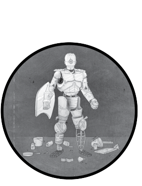

# Chapter 7

## Designing Secure Software-2021

Source: [Designing.Secure.Software-2021-7.pdf](Designing.Secure.Software-2021-7.pdf) — 17 PDF pages.

<!-- Source S7, PDF page 1 -->

### Security Design Reviews

A good, sympathetic review is always a wonderful surprise.

—Joyce Carol Oates

*Figure 7-1: Chapter-opening artwork*

<!-- Source: Designing.Secure.Software-2021-7.pdf, PDF page 1. -->

One of the best ways to bake security into software is to separately review designs with your “security hat” on. This chapter explains how to apply the security and privacy design concepts discussed in the last chapter in a security design review (SDR). Think of this process as akin to when an architect designs a building and an engineer then reviews the design to ensure that it’s safe and sound. Both the designer and the reviewer need to understand structural engineering and building codes, and by working together, they can achieve higher levels of quality and trust.

Ideally, the security reviewer is someone not involved in the design work, giving them distance and objectivity, and also someone familiar with the systems and context within which the software runs and how it will be used. However, these are not firm prerequisites; reviewers less familiar with the design will tend to ask a lot more questions but can also do a fine job.

<!-- Source S7, PDF page 2 -->

Sharing these methods and encouraging more software professionals to perform SDRs themselves was one of my core goals in writing this book. You will almost certainly do a better SDR on the software systems that you work with and know well than someone with more security experience who is unfamiliar with those systems. This book provides guidance to help you with this task, and it’s my hope that in doing so it will contribute in some small way to raising the bar for software security.

### SDR Logistics

Before presenting the methodology for an SDR, it’s important to give a little background and discuss some basic logistics. What purpose does an SDR serve? If we’re going to perform one, during what stage of the design process should this be done? Finally, I’ll give a few tips on preparation and the importance of documentation in particular.

### Why Conduct an SDR?

Having done a few hundred SDRs myself, I can report that it never feels like a waste of time. SDRs take only a tiny fraction of the total design time, and will either identify important improvements to enhance security or provide strong assurance that the design properly addresses security. Simple, straightforward designs are quick to review, and for larger designs the review process provides a useful framework for identifying and validating the major hotspots. Even when you review a design that ostensibly covers all the bases for security, it’s good due diligence to confirm this. And of course, when the SDR does turn up significant issues, the effort proves extremely worthwhile, because detecting these issues during implementation would be difficult and remedying them after the fact would be costly.

In addition, SDRs can yield valuable new insights, resulting in design changes unrelated to security. An SDR offers a great opportunity to involve diverse perspectives (user experience, customer support, marketing, legal, and so forth), with everyone pondering easily overlooked topics such as the potential for abuse and unintended consequences.

### When to Conduct an SDR

Plan on performing an SDR when the design (or design iteration) is complete and stable, typically following the functional review, but before the design is finalized, since there may be changes needed. I strongly recommend against trying to handle security as part of the functional review, because the mindset and areas of focus are so different. Also, it’s important for everyone—not just the reviewer—to focus on security, and that’s difficult to do during a combined review when there’s a tendency to concentrate more on the workings of the designs.

Designs that are complicated or security-critical often benefit from an additional preliminary SDR, when the design is beginning to gel but still not fully formed, in order to get early input on major threats and overall

<!-- Source S7, PDF page 3 -->

strategy. The preliminary SDR can be less formal, previewing points of particular security interest (where you would expect to dig further) and discussing security trade-offs at a high level. Good software designers should always consider and address security and privacy issues throughout the design. To be clear, designers should never ignore security and rely on the SDR to fix those issues for them. They should always expect to be fully responsible for the security of their designs, with security reviewers in a support role helping to ensure that they do a thorough job. In turn, security reviewers shouldn’t pontificate, but instead clearly and persuasively present their findings to designers without judgment.

### Documentation Is Essential

Effective SDRs depend on up-to-date documentation so that all parties have an accurate and consistent understanding of the design under review. Informal word-of-mouth SDRs are better than nothing, but crucial details are easily omitted or miscommunicated, and without a written record, valuable results are easily lost. Personally, I always prefer having design documents to preview ahead of a meeting, so I can start studying the design in advance and not take up meeting time with learning what we are working on.

The quality of the design documentation is, in my experience, an invaluable aid in delivering a great SDR. Of course, thorough documentation may not be available in practice, and the case study beginning on page 122 talks about handling that situation as well. Any design document vaguely specifying to “store customer data securely,” for example, deserves a big red flag, unless it goes on to describe what that means and how to do that. Blanket statements without specifics almost always betray naivety and a lack of a solid understanding of security.

### The SDR Process

The following explanation of the SDR process describes how I conducted them at a large software company with a formal, mandatory review process. That said, software design is practiced in countless different ways, and you can adapt the same strategies and analysis to less formal organizations.

Starting from a clear and complete design in written form, the SDR consists of six stages:

1. Study the design and supporting documents to gain a basic understanding of the project. 2. Inquire about the design and ask clarifying questions about basic threats. 3. Identify the most security-critical parts of the design for closer attention. 4. Collaborate with the designer(s) to identify risks and discuss mitigations. 5. Write a summary report of findings and recommendations. 6. Follow up with subsequent design changes to confirm resolution before signing off.

<!-- Source S7, PDF page 4 -->

For small designs, you can often run through most of these in one session; for larger designs, break up the work by stage, with some stages possibly requiring multiple sessions to complete. Sessions dedicated to meeting with the design team are ideal, but if necessary the reviewer can work alone and then exchange notes and questions with the design team via email or other means.

Everyone has a different style. Some reviewers like to dive in and do a “marathon.” I prefer (and recommend) working incrementally over several days, affording myself an opportunity to “sleep on it,” which is often where my best thinking happens.

The following walkthrough of the SDR process explains each stage, with bullet points summarizing useful techniques. When you perform an SDR you can refer to the bullets for each stage as you work through the process.

### 1. Study

Study the design and supporting documents to gain a basic understanding of the software as preparation for the review. In addition to security know-how, reviewers ideally bring domain-specific expertise. Lacking that, try to pick up what you can, and stay curious throughout the process. Trade-offs are inherent in most security decisions, so a single-minded push for more and more security is likely to overdo things, and risk ruining the design in the process. To understand how too much security can be bad, think of a house designed solely to reduce the risk of fire. Built entirely of concrete, with one thick steel door and no windows, it would be costly as well as ugly, and nobody would want to live in it.

In this preparatory stage:

• First, read the documentation to get a high-level understanding of the design. • Next, put on your “security hat” and go through it again with a threataware mindset. • Take notes, capturing your ideas and observations for future reference. • Flag potential issues for later, but at this stage it’s premature to do much security analysis.

### 2. Inquire

Ask the designer clarifying questions to understand the basic threats to the system. For simpler designs that are readily understood, or when the designer has produced rock-solid documentation, you may be able to skip this stage. Consider it an opportunity to confirm your understanding of the design and to resolve any ambiguities or open questions before proceeding further. Reviewers certainly don’t need to know a design inside and out to be effective—that’s the designer’s job—but you do need a solid grasp of the broad outlines and how its major components interact.

<!-- Source S7, PDF page 5 -->

This stage is your opportunity to fill in gaps before digging in. Here are some pointers:

• Ensure that the design document is clear and complete. • If there are omissions or corrections needed, help get them fixed in the document. • Understand the design enough to be conversant, but not necessarily at an expert level. • Ask members of the team what they worry about most; if they have no security concerns, ask follow-up questions to learn why not.

There’s no need to limit the questions you ask as a security reviewer to strictly what’s in the design document. Understanding peer systems can be extremely helpful for gauging their impact on the design’s security. Omitted details can be hardest to spot. For example, if the design implicitly stores data without providing any details of how this is handled, ask about the storage and its security.

### 3. Identify

Identify the security-critical parts of the design and zero in on them for close analysis. Work from basic principles to see through a security lens: think in terms of C-I-A, the Gold Standard, assets, attack surfaces, and trust boundaries. While these parts of the design deserve special attention, keep the security review focused on the whole for now, so as not to completely ignore the other parts. That said, it’s fine to skip over aspects of the design with little or no relevance to security.

In this exploratory stage you should:

• Examine interfaces, storage, and communications—these will typically be central points of focus. • Work inward from the most exposed attack surfaces toward the most valuable assets, just as determined attackers would. • Evaluate to what degree the design addresses security explicitly. • If needed, point out key protections and get them called out in the design as important features.

### 4. Collaborate

Collaborate with the designer, conveying findings and discussing alternatives. Ideally, the designer and reviewer meet for discussion and go through the issues one by one. This is a learning process for everyone: the designer gets a fresh perspective on the design while learning about security, and the reviewer gains insights about the design and the designer’s intentions, deepening their understanding of the security challenges and the best mitigation alternatives. The joint goal is making the design better overall; security is the focus of the review, but not the only consideration. There’s no need to

<!-- Source S7, PDF page 6 -->

make final decisions on changes on the spot, but it is important to reach an agreement eventually about what design changes deserve consideration.

Here are some guidelines for effective collaboration:

• As a reviewer, provide a security perspective on risks and mitigations where needed. This can be valuable even when the design is already secure, reinforcing good security practice. • Consider sketching a scenario illustrating how a security change could pay off down the line to help convince the designer of the need for mitigations. • Offer more than a single solution to a problem when you can, and help the designer see the strengths and weaknesses of these alternatives. • Accept that the designer gets the last word, because they are ultimately responsible for the design. • Document the exchange of ideas, including what will or will not go into the design.

Expanding on “the last word”: in practice, this balance will depend on the organization and its culture, applicable industry standards, possible regulatory requirements, and other factors. In large or highly regimented organizations, the last word may involve sign-offs by multiple parties, including an architecture board, standards compliance officers, usability assessors, and executive stakeholders. When multiple approvals are required, designers must balance competing interests, so security reviewers should be especially conscientious of this dynamic and be as flexible as possible.

### 5. Write

Write an assessment report of the review findings and recommendations. The findings are the security reviewer’s assessment of the security of a design. The report should focus on potential design changes to consider, and an analysis of the security of the design as it stands. Any changes the designer has already agreed to should be prominently identified as such, and subject to later verification. Consider including priority rankings for suggested changes, such as this simple three-level scheme:

• Must is the strongest ranking, indicating there should be no choice, and often implying urgency. • Ought is intermediate: I use it to say that I, the reviewer, lean “Must” but that it’s debatable. • Should is the weakest ranking for optional recommended changes.

More precise rankings are difficult at the design stage, but if you want to try, Chapter 13 includes guidance on ways to systematically assign more fine-grained rankings for security bugs that can be readily adapted for this purpose.

SDRs vary enough that I have never used a standardized template for the assessment report, but instead write a narrative describing the findings. I like to work from my own rough notes taken over the course of the review,

<!-- Source S7, PDF page 7 -->

with the final form of the report evolving organically. If you can hold all the details in your head reliably, then you may want to write up the report after the review meeting.

The following tips can also be used as a framework for the write-up:

• Organize the report around specific design changes that address security risks. • Spend most of your effort and ink on the highest-priority issues, and proportionally less on lower priorities. • Suggest alternatives and strategies without attempting to do the designer’s job for them. • Prioritize findings and recommendations using priority rankings. • Focus on security, but feel free to offer separate remarks for the designer’s consideration as well. Be more deferential outside the scope of the SDR, don’t nitpick, and avoid diluting the security message.

Separating the designer and reviewer roles is important, but in practice how this is done varies greatly depending on the responsibilities of each and their ability to collaborate. In your assessment report, avoid doing design work, while offering clear direction for needed changes so the designer knows what to do. Offer to review and comment on any significant redesign that results from the current review. As a rule of thumb, a good reviewer helps the designer see security threats and the potential consequences, as well as suggests mitigation strategies without dictating actual design changes. Reviewers who are too demanding often find that their advice is ineffective, even if it is correct, and they risk forcing designers into making changes that they do not fully understand or see the need for.

You can skimp on writing up the report if this level of rigor feels too fussy, but the chances are good that you, or someone else working on the software, will later wish that the details had been recorded for future reference. At a bare minimum, I suggest taking the time to send an email summary to the team for the record. Even a minimal report should not just say “Looks good!” but should back that up with a substantive summary. If the design covered all the security bases, reference a few of the most important design features that security depends on to underscore their importance. In the case of a design where security is a non-factor (for example, I once reviewed an informational website that collected no private information), outline the reasoning behind that conclusion.

The style, length, and level of detail in these reports varies greatly depending on the organizational culture, available time, number of stakeholders, and many other factors. When, as reviewer, you collaborate closely with the software designer, you may be able to incorporate needed provisions directly into the design document, rather than enumerating issues in need of change in a report. Even for small, informal projects, assigning separate designer and reviewer roles is worthwhile so there are multiple sets of eyes on the work, and to ensure that security is duly considered. However, even a solo design benefits from the designer going back over their own work with their security hat on for fresh perspective.

<!-- Source S7, PDF page 8 -->

### 6. Follow Up

Follow up on agreed design changes resulting from a security review to confirm they were resolved correctly. When the collaboration has gone well, I usually just check that documentation updates happened without looking at the implementation (and that approach has never backfired in my experience). In other circumstances, and subject to your judgment, reviewers may need to be more vigilant. Sign off on the review when it’s complete, including the verification of all necessary changes. Assigning the SDR in the project bug tracker is a great way to track progress reliably. Otherwise, use a more or less formal process if you prefer. Here are a few pointers for this final stage:

• For major security design changes, you might want to collaborate with the designer to ensure that changes are made correctly. • Where opinions differ, the reviewer should include a statement of both positions and the specific recommendations that weren’t followed to flag it as an open issue. (“Managing Disagreement” on page 121 talks about this topic in more detail.)

In the best case, the designer looks to the reviewer as a security resource and will continue engaging as needed over time.

### Assessing Design Security

Now that we’ve covered the SDR process, this section delves into the thought processes behind conducting the review. The material in this book up to this point has given you the concepts and tools you need to perform an SDR. The foundational principles, threat modeling, design techniques, patterns, mitigations, crypto tools—it all goes into the making of a secure design.

### Using the Four Questions as Guidance

The Four Questions used for threat modeling in Chapter 2 are an excellent guide to help you conduct an effective SDR. Explicit threat modeling is great if you have the time and want to invest the effort, but if you don’t, using the Four Questions as touchstones is a good way to integrate a threat perspective into your review. More detailed explanations will be given in the subsections that follow, but at the highest level, here is how these questions map onto an SDR:

1. What are we working on? The reviewer should understand the high-level goals of the design as context for the review. What’s the most secure way of accomplishing the goal?

2. What can go wrong? This is where “security hat” thinking comes in, and where to apply threat modeling. Did the design fail to anticipate or underestimate a critical threat?

<!-- Source S7, PDF page 9 -->

3. What are we going to do about it? Review what protections and mitigations you find in the design. Can we respond in better ways to the important threats?

4. Did we do a good job? Assess whether the mitigations in the design suffice, if some might need more work, or if any are missing. How secure is the design, and if lacking, how can we bring it up to snuff?

You can use the Four Questions as a tickler while working on an SDR. If you’ve read the design document and noted areas of focus but don’t know exactly what you are looking for yet, run through the Four Questions— especially #2 and #3—and consider how they apply to specific parts of the design. From there, your assessment will naturally shift to #4. If the answer isn’t “We’re doing just fine,” it likely suggests a good topic of discussion, or an entry you should include in the assessment report.

### What Are We Working On?

There are a few specific ways this question keeps you on track. First, it’s important to know the purpose of the design so you can confidently suggest cutting any part that incurs risk but is not actually necessary. Conversely, when you do suggest changes, you don’t want to break a feature that’s actually needed. Perhaps most importantly, you may be able to suggest an alternative to a risky feature that takes a new direction.

For example, in the privacy space, if you’re reviewing a payroll system that collects personal information from all employees, you might identify a health question as particularly sensitive. If the data item in question is truly superfluous, then cutting it from the design is the right move. However, if it’s important to the business function the design serves, instead you can propose ways to stringently protect against disclosure of this data (such as early encryption, or deletion within a short time frame).

### What Can Go Wrong?

The review should confirm that the designer has anticipated the important threats that the system faces. And it’s not enough for the designer to be aware of these threats; they must have actually created a design that lives up to the task of withstanding them.

Certain threats may be acceptable and left unmitigated, and in this case, the reviewer’s job is to assess that decision. But it’s important to be sure that the designer is aware of the threat and chose to omit mitigation. If the design doesn’t say explicitly that this is what they are doing, note this in the SDR to double-check that it’s intentional. Also note the risk being accepted and explain why it’s tolerable. For example, you might write: “Unencrypted data on the wire represents a snooping threat. However, we determined that the risk is acceptable because the datacenter is physically secured, and there is no potential for exposure of PII or business-confidential data.”

<!-- Source S7, PDF page 10 -->

Try to anticipate future changes that might invalidate this decision to accept the risk. Building on the example just mentioned, you might add, “If the system moves to a third-party datacenter we should revisit this physical network access risk decision.”

### What Are We Going to Do About It?

Security protection mechanisms and mitigations should become apparent in the design as the reviewer studies it. Reviewers typically spend most of their time on the last two questions: identifying what makes the design secure and assessing how secure it is. One way of approaching this task is by matching the threats to the mitigations to see if all bases are covered. Pointing out issues arising from this question and confirming that the design is satisfactory are among the most important contributions of an SDR.

If the design is not doing enough to mitigate security risks, then you should itemize what’s missing. To make this feedback useful, you need to explain the specific threats that are unaddressed, as well as why they are important, and perhaps provide a rough set of options for addressing each. For a number of reasons, I recommend against proposing specific remedies in an SDR. However, it’s great to offer help informally, and if asked, to collaborate with the designer to consider alternatives or even elaborate on design changes. For example, your feedback might say: “The monitoring API should not be exposed publicly because it discloses our website’s levels of use, which could give competitors an advantage. I recommend requiring an access key to authenticate requests to the RESTful API.”

When the design does provide a mitigation for a given threat, evaluate its effectiveness and consider whether there might be better alternatives. Sometimes, designers “reinvent the wheel” by building security mechanisms from scratch: good feedback would be to suggest using a standard library instead. If the design is secure but that’s achieved at a great performance cost, propose another way if you can. An example of this might be pointing out redundant security mechanisms, such as encrypting data that is sent over an encrypting HTTPS connection, and describing how to streamline the design.

### Did We Do a Good Job?

This last question goes to the bottom line: Do you consider the design secure? Competent designers should have already addressed security, so much of the value of the SDR is in assuring that they saw the whole picture and anticipated the major threats. In my experience, SDRs quickly identify issues and opportunities, or at minimum suggest interesting trade-off decisions worth considering now (because later you won’t have the luxury of making changes so easily).

<!-- Source S7, PDF page 11 -->

I recommend summarizing your overall appraisal of the whole design in one statement at the top of the report. Here are some examples of what that might look like:

• I found the design to be secure as is, and have no suggested changes. • The design is secure, but I have a few changes to suggest that would make it even more so. • I have concerns about the current design, and offer a set of recommendations to make it more secure.

After the summary, if there are multiple subpar areas that require fixing, break those out and explain them one by one. If you can attribute the weakness to a specific part of the design, it will be easier for the designer to pinpoint the problem, see it clearly, and make the necessary remedies.

Of course, no design is perfect, so in judging a design to be lacking, it’s important to be clear about what standard you are holding it to. This is difficult to express in the abstract, so a good approach is to point out specific threats, vulnerabilities, and consequences to make your case. It may be best to couch your assessment in terms of the security of a comparable product; for example, “Our main competitor claims to be ransomware-resistant as a major selling point, but this design is particularly susceptible to such attacks due to maintaining the inventory database locally on a computer that employees also use to surf the web.”

### Where to Dig

It’s impractical to dig into every corner of a large design, so reviewers need to focus as quickly as possible on key areas that are security-critical. I encourage security reviewers to follow their instincts when deciding where to direct their efforts within the design. Begin by reading through the design and noting areas of interest according to your intuition. Next, go back to the areas of largest concern, study them more carefully, and collect questions to ask, letting potential threats and the Four Questions be your guide. Some of these leads will be more productive than others. If you do start down an unproductive path, you will usually realize this before long, so you can refocus your efforts elsewhere.

It’s fine to skim parts of the design that are extraneous to security and privacy, absorbing just enough to have a basic understanding of all the moving parts. If you locked yourself out of your home, you would know to check for an open window or unlocked door: nobody would spend time going over the entire exterior inch by inch. In the same way, it’s most effective to zero in on places in the design where you detect a hint of weakness, or focus closely on how the design protects the most valuable assets.

Keep an eye out for attack surfaces and give them due attention. The more readily available they are—anonymous internet exposure is the classic worst case—the more likely they are to be a potential source of attacks.

<!-- Source S7, PDF page 12 -->

Trust boundaries guarding valuable resources, especially when reachable from an attack surface, are the major generic feature of a design that reviewers should be sure to emphasize in their analysis. Sometimes valuable assets can be better isolated from external-facing components, but often the exposure is unavoidable. These are the kinds of factors that reviewers need to search out and assess throughout the process.

### Privacy Reviews

Depending on your skill set and organizational responsibilities, you may want to handle information privacy within the scope of an SDR, or separately. Privacy feedback within an SDR should center on applicable privacy policies and how they relate to data collection, use, storage, and sharing within the scope of the design.

A good technique is to run through the privacy policy and note passages that pertain to the design, then look for ways to protect against violations. As the previous chapter describes, the technical focus is on ensuring that the design is in compliance with policy. Get sign-offs from privacy specialists and legal for issues requiring more expertise.

### Reviewing Updates

Once released, software seems to take on a life of its own, and over time, change is inevitable. This is especially true in Agile or other iterative development practices, where design change is a constant process. Design documents can easily become neglected along the way and, years later, lost or irrelevant. Yet changes to a software design potentially impact its security properties, so it’s wise to perform an incremental SDR update to ensure that the design stays secure.

Design documents should be living documents that track the evolution of the architectural form of the software. Versioned documents are an important record of how the design has matured, or in some cases become convoluted. You can use these same documents as a guide to focus an incremental review on the precise set of changes (the design delta) since the previous SDR to update it. When there are changes to (or near) security-critical areas of the design, it’s often wise for the reviewer to follow up to ensure that no small but important details were omitted in the design document that might have significant impact. If the incremental review does turn up anything substantial, add that to the existing assessment report so it now tells the complete story. If not, just update the report to note what design version it covers.

Underestimating the impact of a “simple change” is a common invitation to a security disaster, and re-reviewing the design is a great way to proactively assess such impacts effectively. If the design change is so minor that a review is unnecessary, it’s also true that a reviewer could confirm right away that there is no security impact. For anything but a trivial design change, I would suggest that there is little to gain from skipping the SDR update, given the risk of missing this important safeguard.

<!-- Source S7, PDF page 13 -->

### Managing Disagreement

Whatever you do in life, surround yourself with smart people who’ll argue with you.

—John Wooden

An important lesson from my years of evangelizing security—learned the hard way, though obvious in hindsight—is that good interpersonal communication is critical to conducting successful SDRs. The analysis is technical, of course, but critiquing a design requires good communication and collaboration, so human factors are also key. Too often, security specialists, be they in-house or outsourced, get reputations (deservedly or not) of being hypercritical interlopers who are never satisfied. That perception subtly poisons interactions, not only making the work difficult, but adversely impacting the effectiveness of everybody’s efforts. We have to acknowledge this factor in order to do better.

### Communicate Tactfully

SDRs are inherently adversarial, in that they largely consist of pointing out risks and potential flaws in designs in which people are often heavily invested. Once identified, design weaknesses often look painfully obvious in hindsight, and it’s easy for reviewers to slip into casting this as carelessness, or even incompetence—but it is never productive to communicate that way. Instead, treat the issues that do arise as teaching opportunities. Once the designer understands the problem, often they will lead the discussion into other productive areas the reviewer might have missed. Having someone point out a vulnerability in your own design is the best way there is to learn security.

An SDR spent ruthlessly tearing apart a weak design with a one-sided lecture on the importance of maximizing security over everything else is unlikely to be productive (for reasons that should be obvious if you imagine yourself on the receiving end). While this does, unfortunately, sometimes happen, I don’t think it’s necessarily because the reviewers are mean, but rather because in focusing on the technical changes needed, it’s easy to forget about keeping the tone respectful. It’s well worth bending over backwards to maintain good will and reinforce that everybody is on the same team, bringing a diversity of perspectives and working toward the common goal of striking the right balance. Sports coaches frequently walk this same fine line, pointing out weaknesses they see (that they know opponents will exploit) without asking too much, in order to help their teams do the work necessary to play their best game. As Mark Cuban says, “Nice goes much further than mean.”

Getting along with people while delivering possibly unwelcome messages is, of course, desirable, but it is also much easier said than done. This is a technical software book, so I offer no self-help advice on how to win friends and influence developers. But the human factor is important enough—or more precisely, ignoring it potentially undermines the work enough—that it merits prominent mention. My fundamental guidance is simple: be aware

<!-- Source S7, PDF page 14 -->

of how you deliver messages and consider how others will receive them and likely respond. To show how this works for an SDR, I offer a true story, and a set of tips that I have come to rely on.

### Case Study: A Difficult Review

One of my most memorable SDRs is a great object lesson in the importance of soft skills. It began with a painful email exchange I initiated just to get documentation and ask a few basic questions. The exchange made it immediately clear that the team lead viewed the SDR as a complete waste of time. On top of that, because they had been unaware of this product launch requirement, it had suddenly become an unwelcome new obstacle blocking the release they were working so hard toward. The first key takeaway from this story is the importance of recognizing the other participants’ perspective on the process, right or wrong, and adapting accordingly.

What documentation I eventually got I found to be sloppy, incomplete, and considerably outdated. Directly pointing this out in so many words would have been unproductive and further soured the relationship. The second key point is that to spur improvement, work around the problem, and handle the SDR effectively, it’s more productive to use strategies like the following:

• Suggest fixes or additions, including the security rationale behind each suggestion. • When feasible, offer to help review documents, suggest edits, or anything else you can do to facilitate the process (but short of doing their job for them). • Present preliminary SDR feedback as “my perspective” rather than as demands. • Use the “sandwich” method: begin with a positive remark, point out needed improvements, then close on a positive (such as how the changes will help). • If your feedback is extensive, ask first how best to communicate it. (Don’t surprise them with a 97-bullet-point email, or by filing tons of bugs out of the blue.) • Explore all the leads that you notice, but limit your feedback to the most significant points. (Don’t be a perfectionist.) • A good rule of thumb is that if missing information is going to be generally useful to many readers it’s worth documenting, but if it’s particular to your needs you should just ask the question less formally. (If necessary, you can include the details of the issue in the assessment report.)

Instead of complaining about or judging the quality of the documentation, find creative alternative ways to learn about the software, such as using an internal prototype if available, or perusing the code and code reviews. Asking to observe a regular team meeting can be a great way to learn about the design without taking up anyone’s time.

<!-- Source S7, PDF page 15 -->

Over email, it felt like they were being rude, but when we finally met I could see that this was just a stressed-out lead developer. Instead of relying exclusively on the lead, I found another team member who was less stretched and was glad to answer my questions. To save time in preparing for the SDR meeting, I pursued only the questions that were important to resolve ahead of time, saving others for the meeting when I had a captive audience.

Preparing for an SDR meeting is a balancing act. You shouldn’t go in cold with zero preparation, because the team may not appreciate having to describe everything, especially after providing you with documentation. Ahead of time, try to identify major components and dependencies you are unfamiliar with, and at least get up to speed enough to ask questions at the meeting. During preparation, a good practice is to jot down issues and questions, then to sort these into categories:

• Questions to ask in advance so you are ready to dig into security when you meet • Questions you can find answers to yourself • Topics best explored at the meeting • Observations you will include in the assessment report that don’t need discussion

By the time we finally held a meeting, the lead engineer was overtly unhappy that the SDR was now the major obstacle to launching the product. The first meeting was a little rocky, but we made good progress, with everyone staying focused. After a few more meetings (which gradually became easier and shorter each time), I signed off on the design. We agreed on a few changes at the first meeting, but confirming the details and meeting to finalize them was an important assurance to all. If you don’t take the time to confirm that needed changes to the design get made, it’s easy for a miscommunication to slip through the cracks.

It’s never easy to convince busy people that you are helping them by taking up their time, and telling them so rarely works. However, flagging even small opportunities to improve security and showing how these contribute to the final product is a great way to reach a mutually satisfactory result.

By the completion of the SDR, the product team had a far better understanding of security—and by extension, of their own product. In the end, they did see the value of the review, and acknowledged that the product had been improved as a result. Better yet, for version two, the team proactively reached out to me and we sailed through the update SDR with flying colors.

### Escalating Disagreements

When the designer and reviewer fail to reach consensus, they should agree to disagree. If the issue is minor, the reviewer can simply note the point of disagreement in the assessment report and defer to the designer. In such cases, make the disagreement explicit, perhaps in a section called “Recommendations Declined,” explaining the suggested design change and

<!-- Source S7, PDF page 16 -->

why you recommended it, as well as the potential consequences of not making the change. However, if there is a serious dispute about a major decision, the reviewer should escalate the issue.

In this case both the designer and the reviewer should write up their positions, starting with an attempt at identifying some common starting ground that they do agree on, and exchange drafts so everyone knows both perspectives. Their respective positions combine to form a memo explaining the risk, along with proposed outcomes and their costs. This memo supplements the assessment report and serves as the basis for a meeting, or as a guide for management to decide how to proceed. The results of the final decision, along with the escalation memo, should go into the assessment report.

Over many years of conducting security reviews, I have never had occasion to escalate an issue, but I have come close a few times. Strong disagreement almost always originates from a deep split in basic assumptions that, once identified, usually leads to resolution. Such differences often stem from implicit assumptions about the software’s use, or what data it will process. In actual practice, how software gets used is extremely hard to control, and over time use cases usually evolve, so leaning to the safe side is usually the best course.

Another major cause of disconnect happens when the designer fails to see that data confidentiality or integrity matters, usually because they are missing the necessary end user perspective or not considering the full range of possible use cases. One more important factor to consider is this: Hypothetically, if we changed our minds after release, how much harder would the change be to make at that stage? Nobody wants to say “I told you so” after the fact, but putting the opposing conditions in writing is usually the best way to make the right choice.

### Practice, Practice, Practice

To solidify what you have learned in this chapter and truly make it your own, I strongly encourage readers to take the leap, find a software design, and perform an SDR for it. If there is no current software design in your sphere of interest just now, choose any available existing design and review it as an exercise. If the software you chose has no formal written design, start by creating a rough representation of the design yourself (it doesn’t have to be a complete or polished document, even a block diagram will do), and review that. Generally, it’s best to start with a modest-sized design so you don’t get in over your head, or carve out a component from a large system and review just that part. Having read this far should have prepared you to begin. You can start by doing quick reviews for your own use if you don’t feel confident enough yet to share your assessment reports.

As you acquire the critical skills of SDR, you can apply them to any software you encounter. Studying lots of designs is a great way to learn about

<!-- Source S7, PDF page 17 -->

the art of software design—both by seeing how the masters do it and by spotting mistakes that others have made—and practicing applying them in this way is an excellent exercise to grow your skills.

An especially easy way to start is to review the sample design document in Appendix A. The security provisions are highlighted, to provide a realistic example of what to look for in designs. Read the design, noting the highlighted portions, and then imagine how you would identify and supply those security-related details if they were missing. For a greater challenge, look for additional ways to make the design even more secure (by no means do I claim or expect it to be a flawless ideal!).

With each SDR, you will improve your proficiency. Even when you don’t find any significant vulnerabilities, you will enhance your knowledge of the design, as well as your security skills. There certainly is no shortage of software in need of security attention, so I invite you to get started. I believe how quickly you acquire this valuable skill set will surprise you.

### Security Design Reviews
