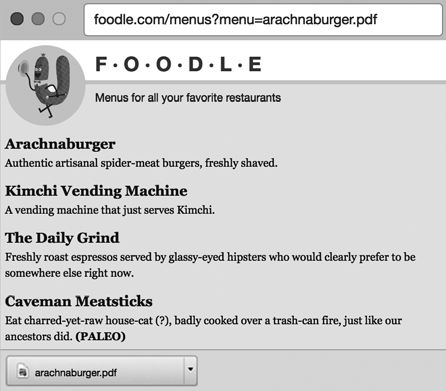
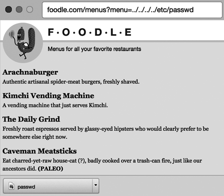

# Chapter 11

## Web Security for Developers-2020

Source: [Web.Security.for.Developers-2020-11.pdf](Web.Security.for.Developers-2020-11.pdf) — 10 PDF pages.

<!-- Source S11, PDF page 1 -->

### Permissions


*Figure 11-3: Chapter-opening artwork*

<!-- Source: Web.Security.for.Developers-2020-11.pdf, PDF page 1. -->

Users on your website will usually have different levels of permissions. In a content management system, for instance, some users are administrators who have the ability to edit the site’s content, while most users can only view and interact with the content. Social media sites

have a more complex web of permissions: users may opt to share only certain content with friends or to keep their profile locked. For webmail sites, each user should be able to access only their own email! It’s important that you correctly and uniformly enforce these types of permissions across your site, or your users will lose trust in you.

Facebook suffered a disastrous failure in user permissions in September 2018, when hackers exploited a bug in its video uploading tool to generate access tokens for the site. Up to 50 million user accounts on the site were compromised. Hackers stole private profile details like users’ names, emails, and phone numbers. Facebook patched the bug, issued a security advisory, and did an apology tour via the press. However, this came at the

<!-- Source S11, PDF page 2 -->

end of a year that contained a lot of unfavorable stories about Facebook’s business practices, and the company’s share price took a battering.

The Facebook hack was an example of privilege escalation, whereby a malicious user usurps the permissions of another user. The process of securing your site so the correct privileges are applied to each user is called implementing access control. This chapter covers both concepts and presents one common method hackers use to exploit insufficient access control, called directory traversal.

### Privilege Escalation

Security experts divide privilege escalation attacks into two categories: vertical and horizontal escalation.

In vertical escalation, an attacker gets access to an account with broader permissions than their own. If an attacker can deploy a web shell on your server—an executable script that takes elements of the HTTP request and runs them on the command line—one of their first aims will be to escalate their way to root privilege, so they can perform any actions they wish on the server. Ordinarily, commands sent to the web shell will be executed under the same operating system account that the web server is running, which generally has limited network and disk access. Hackers have found a lot of ways to perform vertical escalation attacks on operating systems in an attempt to get root access—which allows them to infect the whole server from a web shell.

In horizontal escalation, an attacker accesses another account with similar privileges as their own. In the last couple of chapters, we’ve discussed common ways of performing this type of attack: guessing passwords, hijacking sessions, or maliciously crafting HTTP request data. The September 2018 Facebook hack was an example of horizontal escalation, caused by an API that issued access tokens without correctly verifying the user’s permissions.

To secure your site from escalation attacks, you need to securely implement access control for all sensitive resources. Let’s discuss how.

### Access Control

Your access control strategy should cover three key aspects:

Authentication Correctly identifying a user when they return to the site Authorization Deciding which actions a user should and shouldn’t be able to perform after they’ve identified themselves Permission checking Evaluating authorization at the point in time when a user attempts to perform an action

Chapters 9 and 10 covered authentication in detail; you saw how securing login functionality and session management allows you to reliably determine which user is making HTTP requests. However, from there, you still need to determine which actions each user can perform, and this is a more open-ended problem.

<!-- Source S11, PDF page 3 -->

A good access control strategy consists of three stages: designing an authorization model, implementing the access control, and testing the access control. After you’ve done that, you can also add audit trails and make sure you haven’t missed common oversights. Let’s go through each of these in detail.

### Designing an Authorization Model

There are several common ways to model authorization rules in a software application. When you design your authorization model, it’s important to document how you’ll apply your chosen model to your users. Without an agreed-upon set of rules, it’s hard to define what a “correct” implementation looks like.

With that in mind, let’s look at some common ways to model authorization rules.

### Access Control Lists

Access control lists (ACLs) are a simple way of modeling authorization that attach against each object in your system a list of permissions, specifying the actions that each user or account can perform on that object. The canonical example of an ACL-based model is the Linux filesystem, which can individually grant each user read, write, or execute permissions on each file and directory. Most SQL databases also implement ACL-based authorization—the account you use to connect to the database determines which tables you can read or update, or whether you can change table structures.

### Whitelists and Blacklists

A simpler way to model authorization is to use a whitelist or blacklist. A whitelist describes the users or accounts that can access a particular resource, and bans all other users. A blacklist explicitly describes the users or accounts that are banned from accessing a resource, implying that the resource should be made accessible to any other user or account. Spam filters frequently use whitelists and blacklists to distinguish email addresses that the email application should send directly to the spam folder or that it should never junk.

### Role-Based Access Control

Probably the most comprehensive authorization model is role-based access control (RBAC), which grants users roles, or adds users to groups that it has granted specific roles. Policies in the system define how each role can interact with specific subjects—resources within the computing system.

A simple RBAC-system might designate certain users as administrators by adding a user to the Administrators group, which in turn grants them the Administrator role. A policy would then permit users or groups with the Administrator role to edit particular pieces of content of your site.

The Amazon Web Services identity and access management (IAM) system is an example of a comprehensive role-based system, as is Microsoft’s Active

<!-- Source S11, PDF page 4 -->

Directory. Role-based access control is powerful but often prone to complexity. Policies can contradict each other, creating conflicts that developers need to resolve, and users can belong to many groups with overlapping concerns. In such cases, it can sometimes be hard to see why a system is making certain access control decisions, or prioritizing certain rules in a particular set of circumstances.

### Ownership-Based Access Control

In the age of social media, it has become common to organize access control rules around the idea of ownership, whereby each user has full control over the photos they upload or the posts they create. Social media users are, in essence, administrators of their own content: they can create, upload, delete, and control visibility on their own posts, comments, photos, and stories. They can tag other users in content such as photos, though those other users may have to approve those tags before the tags are made public. On a social media site, each type of content has an implied privacy level: commenting on each other’s posts is usually done in public, but direct messages are private (though someone should try explaining that to my grandmother).

### Implementing Access Control

After you’ve chosen your authorization model and defined the access rules for your site, you’ll need to implement them in code. You should attempt to centralize access control decisions in your codebase, which makes it easier to validate them against your design documents during code reviews. You don’t necessarily need to have all access decisions flow through one code path, but it’s important to have a standard method of evaluating access control decisions.

There are many ways of implementing authorization rules: using function or method decorators (which tag functions with certain permission levels), URL checking (for example, prefixing sensitive paths with /admin), or inserting inline assertions in the code. Some implementations will defer to access control decisions from a dedicated permission component or inhouse API. Listing 11-1 shows an example of adding permission checking to Python functions.

```text
from django.contrib.auth.decorators import login_required, permission_required

[1] @login_required
[2] @permission_required('content.can_publish')

def publish_post(request):
    # Publish a post to the front page.
```

Listing 11-1: Checking permissions using the `django` web server in Python

The web server requires that the user is logged in [1] and has permissions to publish content [2] before permitting them to publish a post.

Listing 11-2 shows how to check permissions inline in Ruby, using the `pundit` library.

<!-- Source S11, PDF page 5 -->

```text
   def publish
     @post = Post.find(params[:id])
  [1] authorize @post, :update?

  @post.publish!
  redirect_to @post
end
```

Listing 11-2: Checking permissions by using the `pundit` library in Ruby

The method call [1] asks the library whether the currently logged-in user has permission to update the social media post described by the `@post` object.

Whatever method you use to implement permission checking, be sure to make access control decisions based on properly vetted identity data. Don’t rely on anything in the HTTP request besides the session cookie to infer which user is accessing a resource and what permissions they have! A malicious user can tamper with anything else in the request in order to commit privilege escalation attacks.

### Testing Access Control

It’s important to test your access control system critically. Make sure your testing procedures genuinely attempt to find holes in your access control scheme; if you treat it like an attacker would, you’ll be better prepared when your first real attack occurs.

Write unit tests that make assertions about who can access certain resources and, more importantly, who shouldn’t be able to access them. Get in the habit of writing new unit tests describing access control rules as you add features to your site. This is especially important if your site has administrative interfaces, since they’re a common backdoor that attackers exploit when hacking websites. Listing 11-3 shows a simple unit test in Ruby that asserts that users must be logged in before performing a sensitive action.

```text
class PostsTest < ApplicationSystemTestCase
  test "users should be redirected to the login page if they are not logged in" do
     visit publish_post_url
     assert_response :redirect
     assert_selector "h1", text: "Login"
  end
end
```

Listing 11-3: A Ruby unit test that checks if an unauthorized user is redirected to the login page if they attempt to publish a post

Finally, if you have the time and budget, consider employing an external team to perform penetration testing. The team can probe for missing or erroneous access control rules that an attacker can abuse.

### Adding Audit Trails

Because your code will be identifying users and testing their authorization levels as they access resources, you should add audit trails to help with

<!-- Source S11, PDF page 6 -->

troubleshooting and forensic analysis. Audit trails are log files or database entries that are recorded whenever a user performs an action. Simply adding logging statements as users navigate your site (`14:32:06 2019-02-05: User example` `@gmail.com logged in`) can help you diagnose any problems as they occur at runtime, and provide vital evidence in the event that you do get hacked.

### Avoiding Common Oversights

A common oversight you see on many websites is that that they omit access control for resources that aren’t designed to be discoverable. It’s easy to assume that pages on your site that aren’t linked to from elsewhere will be hidden from hackers, because those pages won’t be highlighted as hackers crawl your site. This isn’t true.

Hacking tools can quickly enumerate private URLs that feature opaque IDs, like http://example.com/item?id=423242, and it’s even easier to access private URLs with a guessable structure like http://example.com/profiles/user/bob. Relying on an attacker being unable to guess a URL is called security through obscurity and is considered a risk.

Securing sensitive resources is particularly important for sites designed to embargo resources, making them accessible at a certain point in time. Financial reporting sites often operate under this constraint. Publicly traded companies are required to make quarterly or semiannual financial reports available to all investors simultaneously, from previously agreed-upon reporting channels.

Some websites upload these reports early (say, to URLs with the form /reports/&lt;company-name&gt;/&lt;month-year&gt;), and cheating investors have been known to check these URLs ahead of time in order to access reports before the rest of the market. Financial watchdogs have charged companies large fines for improper disclosure due to broken access logic! Make sure your access control rules account for any timing requirements.

Every sensitive resource on your site requires access control. If your site allows users to download files, hackers may try to access files that they should not be permitted to download, using a hacking method called directory traversal. Let’s see how.

### Directory Traversal

If any of your website’s URLs contain parameters describing paths to files, attackers can use directory traversal to bypass your access control rules. In a directory traversal attack, an attacker manipulates the URL parameters in order to access sensitive files that you never intended to be accessible. Directory traversal attacks usually involve replacing a URL parameter with a relative filepath that uses the ../ syntax to “climb out” of the hosting directory. Let’s break down how this works.

### Filepaths and Relative Filepaths

In most filesystems, the location of each file can be described by a filepath. For instance, the filepath /tmp/logs/web.log on Linux describes the location

<!-- Source S11, PDF page 7 -->

of the file web.log by enumerating the directories (in this case, the logs directory within the top-level tmp directory) that contain the file, joined by a path separator character (/).

A relative filepath is a filepath that begins with the period (.) character, denoting it as being in the current directory; the relative path ./web.log describes the location of the file web.log as being in the current directory. What’s considered the “current” directory depends on the context under which the path is being evaluated. From a command line prompt, for instance, the current directory is the one the user most recently navigated to.

Relative paths also use the .. syntax to reference the containing or parent directory. Using the .. syntax twice would reference the parent directory of the parent directory of the current directory. For instance, the filesystem interprets the path ../../etc/passwd as a request to go up two directories, find a directory called etc, and then return the passwd file within that directory. Using a relative path is similar to describing a relative: your uncle is your grandparent’s son, so to find him, go back two generations in your family tree and then look for a male child.

If your server-side code allows an attacker to pass and evaluate relative filepaths in place of filenames, they can probe your filesystem for interestinglooking files, breaking access control. The relative path syntax lets the attacker read files outside the web server’s home directory, letting them probe for directories that commonly hold password or configuration information and read the data contained within them. Let’s look at an example of such an attack.

### Anatomy of a Directory Traversal Attack

Imagine you have a website that hosts restaurant menus stored as PDFs on your server’s filesystem. Your site invites users to download each PDF by clicking a link that references a filename, as shown in Figure 11-1.



*Figure 11-1: A website that allows files to be downloaded*

<!-- Source: Web.Security.for.Developers-2020-11.pdf, PDF page 7. -->

<!-- Source S11, PDF page 8 -->

If the filename parameter isn’t securely interpreted, an attacker can swap in a relative path in place of the menu filename in the URL, and get access to user account information on your server, as shown in Figure 11-2.



*Figure 11-2: Using a directory traversal attack to access a Unix file holding account information*

<!-- Source: Web.Security.for.Developers-2020-11.pdf, PDF page 8. -->

In this instance, the hacker has replaced the name of the menu in the `menu` parameter with a relative path (../../../../etc/passwd) in order to download a sensitive file. Reading the passwd file tells the attacker which user accounts exist on the underlying Linux operating system, revealing sensitive system information that will help the attacker hack the server. You certainly don’t want an attacker to be able to read this kind of information! Let’s look at ways to defuse directory traversal.

### Mitigation 1: Trust Your Web Server

To protect yourself against directory traversal attacks, first familiarize yourself with how your web server resolves static content URLs. Almost all websites will transform URLs into filepaths in some fashion—often when the server answers requests for static content such as JavaScript files, images, or stylesheets. If you find yourself serving more-exotic types of static files (for example, restaurant menus), try to use the web server’s built-in URL resolution logic rather than writing your own. Your web server’s URL static hosting capabilities are generally battle-tested and secured against directory traversal attacks.

### Mitigation 2: Use a Hosting Service

If you serve files that aren’t part of your codebase, perhaps because users or site administrators upload them, you should strongly consider hosting them in a content delivery network, in cloud storage, or in a content management system. These software types not only mitigate file upload vulnerabilities, as

<!-- Source S11, PDF page 9 -->

discussed in Chapter 6, but also defuse directory traversal attacks by allowing you to refer to files either by secure URLs or opaque file identifiers. Of these alternatives, CDNs typically allow for less fine-grained permissions (say, if certain files need to be available to only certain users) but are also typically easiest to integrate with.

### Mitigation 3: Use Indirect File References

If you write your own code to serve files from a local disk, the most secure way of defusing directory traversal attacks is via indirection: you assign each file an opaque ID that corresponds to a filepath, and then have all URLs reference each file by that ID. This requires you to keep some sort of registry that pairs each file ID to a path, say, within a database.

### Mitigation 4: Sanitize File References

Finally, if you do end up using direct file references in your URLs—perhaps because you inherit a legacy codebase and lack the time or resources necessary to refactor the way files are stored—you need to secure your site code to ensure that arbitrary paths can’t be passed in place of filenames. The most secure approach is simply banning any file reference that includes path separator characters, including encoded separator characters. (Note that Windows- and Unix-based operating systems use different path separators: \ and /, respectively.)

Another approach is to validate filenames against a regular expression (regex) to filter out anything that looks like path syntax. All modern web programming languages contain some sort of regex implementation, so it’s easy to test an incoming filename parameter against a “safe” expression. Be careful with this technique, though: hackers continuously research new and obscure ways to encode pathnames, because directory traversal attacks are so common. If possible, try to use a third-party library to sanitize filenames. Listing 11-4 shows some logic in the Ruby Sinatra gem that sanitizes path parameters.

```text
   def cleanup(path)
     parts     = []
  [1] unescaped = path.gsub(/%2e/i, dot).gsub(/%2f/i, slash).gsub(/%5c/i, backslash)

  unescaped = unescaped.gsub(backslash, slash)

  [2] unescaped.split(slash).each do |part|

    next if part.empty? or part == dot
    part == '..' ? parts.pop : parts << part
  end

  [3] cleaned = slash + parts.join(slash)

  cleaned << slash if parts.any? and unescaped =~ %r{/\.{0,2}$}
  cleaned
end
```

Listing 11-4: Logic for sanitizing path parameters in the Sinatra Ruby gem

<!-- Source S11, PDF page 10 -->

First the code standardizes any obscure character encodings it identifies [1]. Then it splits the path into separate components [2]. Finally, it reconstitutes the path by using a standard separator [3], ensuring that the leading character is a slash.

The complexity illustrated in Listing 11-4 is necessary because relative paths can be encoded in various ways during a directory traversal attack. Listing 11-5 shows eight ways the parent directory syntax can be encoded on different operating systems.

```text
../
..\
..\/
%2e%2e%2f
%252e%252e%252f
%c0%ae%c0%ae%c0%af
%uff0e%uff0e%u2215
%uff0e%uff0e%u2216
```

Listing 11-5: Relative paths can be encoded in many ways for different operating systems. Gulp.

### Summary

Users on your website will usually have different levels of permissions, so you need to implement access control rules that are evaluated when a user attempts to access a resource. Access control rules need to be clearly documented, comprehensively implemented, and aggressively tested. Development timelines should include sufficient padding to allow the team to evaluate the security implications of all new code changes.

Static resources that are referred to by filename are vulnerable to directory traversal attacks, a common method of overcoming access control rules. Directory traversal attacks can be thwarted by using your web server’s existing method of serving static files, serving static files from a secure third-party system, or referencing static files via indirection. If you’re forced to use filenames, make sure to sanitize any HTTP parameters that are used to construct filepaths.

In the next chapter, you’ll look at some ways your website may be advertising the technology stack you are using, which will give hackers an idea of how to attack it.
